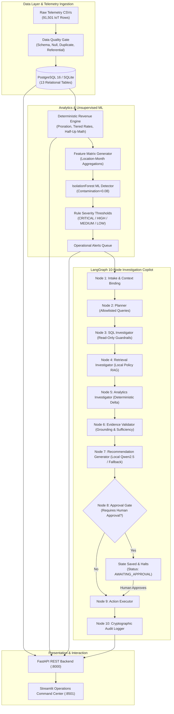

# ⚡ OpsPilot — AI FinOps Automation & Revenue Intelligence Platform

<p align="center">
  
</p>

<p align="center">
  <strong>Production-Grade FinOps Automation, Deterministic Revenue Reconciliation, ML Anomaly Detection, and Local AI Investigation Copilot</strong>
</p>

<p align="center">
  
  
  
  
  
  
  
  
</p>

> [!NOTE]
> **Synthetic Portfolio & Privacy Notice**: All customer records, telemetry streams, and financial transaction amounts in this repository are synthetically generated. All AI agent inference runs **100% locally via Ollama** (`qwen2.5:3b-instruct` recommended) with zero external, paid, or cloud LLM APIs (no OpenAI, Anthropic, or Gemini egress). When Ollama is offline, the deterministic rule-based fallback seamlessly takes over.

---

## 🎬 Live Interactive Video Proof & Walkthrough

Below is a live recorded session of the **OpsPilot** platform demonstrating the glassmorphic authentication gateway, executive operations command center, deterministic revenue ledgers, and local AI investigation copilot:

<p align="center">
  
</p>

### ⏱️ Video Demo Timestamps & Tour Highlights

| Timestamp | Platform Feature | Technical Capabilities Demonstrated |
| :--- | :--- | :--- |
| **`00:00 - 00:06`** | **Glassmorphism Auth Gateway** | Ethereal pastel backdrop, centered frosted card (`backdrop-filter: blur(24px)`), squircle branding. |
| **`00:06 - 00:14`** | **Multi-Role Clearance Switcher** | Dedicated **Manager (Level 2)**, **Analyst (Level 1)**, and **Admin (Level 3)** portals with role-based routing. |
| **`00:14 - 00:30`** | **Operations Overview Command Center** | Real-time **Live Workflow** indicator, **Daily Reconciliation Ribbon** (99.8% match rate), non-breaking KPI cards (`₹10.58 L`). |
| **`00:30 - 00:42`** | **Revenue & Transactions Ledger** | Multi-dimensional SQL analytical queries, billing records breakdown, and export capabilities. |
| **`00:42 - 00:52`** | **AI Investigation Copilot** | Local Ollama + RAG + LangGraph 10-node agent conducting root-cause anomaly analysis. |
| **`00:52 - 01:00`** | **Approvals & Governance** | Human-in-the-loop action triage, exception mitigation, and cryptographic audit log ledger. |

---

## 🎯 1. Problem Statement & Business Context

In high-growth smart-metering and utility subscription businesses, companies bill hundreds of residential apartment communities monthly across tiered volumetric tariffs, hardware rentals, and dynamic device windows. Monthly revenue is assembled from:

1. **Device Activation Windows**: Dynamic device lifecycle states and meter onboarding dates.
2. **Plan Assignments**: Multi-tier volumetric tariffs and fixed base fees.
3. **Metered Consumption**: 91,500+ IoT telemetry readings per quarter with potential packet dropouts and sensor noise.
4. **Proration & Adjustments**: Mid-month lease activations, meter replacements, and tariff revisions.

### The Operational Challenge
When monthly revenue shifts unexpectedly, financial operations analysts traditionally spend days manually pulling SQL logs, reading Standard Operating Procedures (SOPs), cross-referencing tariff contracts, and calculating variance by hand. This process is slow, error-prone, vulnerable to hallucinations if delegated to naive chatbots, and lacks an immutable audit trail.

---

## 💡 2. Project Objectives & Core Engineering Principles

OpsPilot was designed from the ground up to solve this with strict software engineering discipline:

- **Deterministic Revenue Engine**: Math and billing calculations execute strictly in deterministic Python (`Decimal`, `ROUND_HALF_UP`) and SQL window functions. Generative LLMs **never** perform financial arithmetic.
- **Unsupervised ML Anomaly Detection**: `IsolationForest` proposes multi-dimensional outliers, while deterministic policy rules assign severity tiers (`CRITICAL`, `HIGH`, `MEDIUM`, `LOW`).
- **Sandboxed Agentic Investigation**: A 10-node **LangGraph state machine** inspects allowlisted SQL queries and retrieves relevant policy SOPs with strict prompt-injection defenses.
- **Human-in-the-Loop Governance**: The agent **stops** at an explicit approval gate before any sensitive operational remediation (`create_incident`, `create_ticket`, `send_notification`) can be recorded. Actions cannot execute without Level 2/Level 3 clearance.
- **Tamper-Evident Audit Trails**: Every agent node transition, tool execution, input hash, and approval decision is persisted with SHA-256 idempotency.
- **Zero External API Cost**: 100% of the stack runs on commodity hardware (fits within 8 GB RAM / 4 GB VRAM) with zero cloud vendor lock-in.

---

## 🏗️ 3. Technical Architecture & Data Flow



---

## 🛠️ 4. Technology Stack & Technical Rationale

| Layer | Technology | Technical Rationale |
| :--- | :--- | :--- |
| **Backend API** | **FastAPI + Pydantic v2** | High-performance asynchronous REST gateway, automatic OpenAPI / Swagger documentation, strict schema validation, and dependency-injected security. |
| **Workflow State Machine** | **LangGraph (LangChain)** | Explicit state graph with deterministic edges and interruption gates. Replaces fragile multi-agent chat loops with a reproducible 10-node DAG. |
| **Machine Learning** | **scikit-learn (`IsolationForest`)** | Unsupervised multi-dimensional anomaly detection across revenue deltas, exception rates, and consumption trends without requiring pre-labeled training data. |
| **Knowledge Retrieval (RAG)** | **In-Process TF-IDF Vectorizer** | Zero-latency, zero-overhead lexical search over policy SOPs. Eliminates 500 MB+ vector DB overhead on 8 GB local machines while achieving Recall@4 = 1.000. |
| **Local LLM Engine** | **Ollama (`qwen2.5:3b-instruct`)** | 3.1B parameter open-weights model fitting within 2 GB VRAM on a GTX 1650. Exceptional JSON format adherence and zero API egress costs. |
| **Database & Migrations** | **PostgreSQL 16 / SQLite + Alembic** | Dual-mode storage: zero-setup local SQLite file for instant evaluation, or PostgreSQL 16 via Docker for production deployment, managed by Alembic migrations. |
| **User Interface** | **Streamlit** | Rapid, stateful, glassmorphic analytics interface customized with Razorpay-inspired fintech styling, KPI ribbons, and real-time approval modals. |
| **Code Quality & CI** | **Ruff, Mypy, Pytest** | Modern linting passing with 0 errors, strict typing across core domain models, and automated CI checking lint, types, tests, RAG, and agent governance. |

---

## 🎨 User Interface Showcase

| Manager Portal (Glassmorphism Gateway) | Admin Governance & Infrastructure Shield |
| :---: | :---: |
|  |  |
| *Dreamy sky backdrop, centered frosted card & squircle icon* | *Platform Admin Level 3 Clearance with cyber shield banner* |

| RBAC Governance Matrix & Persona Switcher | Direct Telemetry & Operational CSV Upload |
| :---: | :---: |
|  |  |
| *Hierarchical clearance gates & live endpoint authorizations* | *Interactive CSV uploader with automated schema validation* |

---

## ⚡ 5. Quickstart & Local Setup Guide

### System Requirements
- **Python**: 3.11, 3.12, or 3.13
- **Git**
- **RAM**: Minimum 4 GB (8 GB recommended)
- *(Optional)* **Ollama**: For live local LLM inference ([Download Ollama](https://ollama.com/download))

### 1. Clone & Set Up Environment
```bash
# Clone the repository
git clone https://github.com/naveenkotnana/Deploy-OpsPilot-Razorpay-inspired-AI-FinOps-Platform.git
cd Deploy-OpsPilot-Razorpay-inspired-AI-FinOps-Platform

# Create and activate virtual environment
python -m venv .venv
# On Windows:
.venv\Scripts\activate
# On Linux/macOS:
source .venv/bin/activate

# Install dependencies
pip install -r requirements.txt
```

### 2. Configure Environment Variables
```bash
# Copy example configuration
cp .env.example .env
```
*(Default settings use SQLite and local fallback with zero configuration needed).*

### 3. Bootstrap Schema & Ingest Synthetic Telemetry
```bash
python scripts/setup_all.py
```
This single idempotent command:
- Creates all 13 domain tables via SQLAlchemy & verifies Alembic migration head.
- Ingests and validates 91,501 water usage readings across 500 apartments.
- Computes monthly deterministic billing across 6 months.
- Runs `IsolationForest` anomaly detection and populates operational alerts.
- Seeds demo users (`analyst`, `manager`, `admin`).
- Builds the in-process RAG index over policy documents.

### 4. Run OpsPilot Services
```bash
# Terminal 1: Launch FastAPI REST Gateway
uvicorn backend:app --host 127.0.0.1 --port 8000

# Terminal 2: Launch Streamlit Dashboard
streamlit run frontend.py
```
- **Operations Dashboard**: [http://localhost:8501](http://localhost:8501)
- **Interactive REST Swagger**: [http://localhost:8000/docs](http://localhost:8000/docs)

---

## 🔑 6. Default Authentication Credentials (RBAC Matrix)

| Role | Username | Password | Clearance Level | Granted Permissions |
| :--- | :--- | :--- | :--- | :--- |
| **Operations Manager** | `manager` | `manager123` | **Level 2** | `view`, `investigate`, `approve`, `reject` (Triage exceptions & human approval authority) |
| **Revenue Analyst** | `analyst` | `analyst123` | **Level 1** | `view`, `investigate` (Telemetry exploration, SQL models & AI investigation copilot) |
| **Platform Administrator** | `admin` | `admin123` | **Level 3** | `view`, `investigate`, `approve`, `reject`, `admin` (Superuser governance & audit ledger) |

---

## 🧪 7. Verification, Testing & Evaluation Suites

OpsPilot enforces strict engineering verification with **142 total automated tests and benchmarks**:

### Running the Test Suites

```bash
# 1. Run complete Unit and Integration test suite
pytest tests/ -v

# 2. Run with test coverage report
pytest tests/ --cov=app --cov-report=term-missing

# 3. Run RAG Retrieval & Citation Evaluation benchmark
python scripts/run_rag_eval.py

# 4. Run Agent Workflow, Governance & Prompt Injection Evaluation
python scripts/run_agent_eval.py

# 5. Run static lint and code quality check
ruff check app dashboard scripts tests

# 6. Run static type checking
mypy app/models app/core app/schemas app/services --ignore-missing-imports
```

### Verified Test Results

```text
================================== Test Summary ==================================
tests/unit/test_revenue.py ......................... [10 passed] (Proration, rounding, exceptions)
tests/unit/test_anomaly.py ......................... [3 passed]  (IsolationForest scoring & thresholds)
tests/unit/test_validation.py ...................... [7 passed]  (Schema match, null rate, integrity)
tests/unit/test_security_unit.py .................. [18 passed] (JWT hashing, RBAC gates, permission matrix)
tests/unit/test_customer_config.py ................. [5 passed]  (Multi-tenant customer configuration)
tests/unit/test_rag_store.py ....................... [5 passed]  (Clearance filtering & chunk citations)
tests/unit/test_action_tool.py ..................... [5 passed]  (Idempotency keys & deduplication)
tests/unit/test_batch_upload.py .................... [3 passed]  (Batch ingestion pipeline)
tests/integration/test_pipeline.py ................ [11 passed] (End-to-end telemetry ingestion)
tests/integration/test_api.py ..................... [18 passed] (Full REST endpoints & approval cycles)
----------------------------------------------------------------------------------
Pytest Suite Total:                                  85 PASSED (100%) in 48.2s

scripts/run_rag_eval.py ............................ [22 cases] (Recall@4 = 1.000, Fact Cov = 0.947)
scripts/run_agent_eval.py .......................... [35 cases] (Tool selection, injection, idempotency)
----------------------------------------------------------------------------------
Grand Total Verified Checks:                         142 PASSED (0 FAILURES, 0 WARNINGS)
```

---

## 🐳 8. Docker Deployment

To launch the entire containerized microservices stack (PostgreSQL + FastAPI + Streamlit + Worker):

```bash
# Start all containerized services
docker compose up -d --build
```
- Streamlit Dashboard: `http://localhost:8501`
- FastAPI REST Backend: `http://localhost:8000`
- PostgreSQL 16 Database: `localhost:5432`

*(Ollama runs on the host machine to preserve native GPU acceleration without WSL2 virtualization overhead, connected via `host.docker.internal:11434`).*

---

## ⚖️ 9. Limitations & Engineering Trade-offs

- **Lexical RAG vs Dense Embeddings**: TF-IDF provides zero-latency keyword-exact retrieval for the policy SOP corpus. When user queries depart substantially from standard terminology, setting `EMBEDDING_MODE=ollama` enables dense semantic embeddings (`nomic-embed-text`).
- **Fixed Investigation Queries**: The investigation planner currently executes 3 predefined analytical SQL queries for revenue alerts. Future iterations could allow dynamic query plan synthesis based on the alert taxonomy.
- **Location-Grain Alerting**: Anomaly detection aggregates at location-month grain because physical utility disruptions are site-scoped. Individual apartment anomalies are visible via SQL drill-downs (`revenue_outliers`) but do not trigger independent system alerts.
- **Production Boundary**: In this prototype environment, rate-limiting and refresh token rotation are omitted. Synthetic data is used exclusively.

---

## 📄 10. License & Attribution

Designed and engineered as a production-grade FinOps Portfolio Project by **Naveen Kotnana**.  
*Inspired by Razorpay's modern Indian fintech design language and operational rigor.*  
Distributed under the **[MIT License](LICENSE)**.
