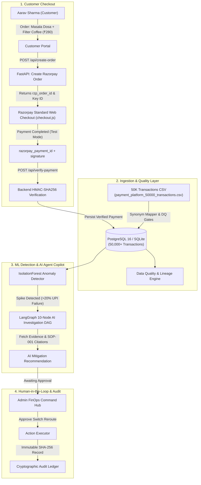

# ⚡ PayBridge Payments — AI-Powered FinOps & Payment Operations Platform

<p align="center">
  
</p>

<p align="center">
  <strong>An Enterprise-Grade Payment Operations Platform Featuring Razorpay Standard Web Checkout, Real-Time Bank Switch Observability, 50,000-Transaction Data Engineering Ingestion, ML Anomaly Detection, and Sandboxed Local AI Agent Investigation</strong>
</p>

<p align="center">
  
  
  
  
  
  
  
  
  
  
</p>

> [!NOTE]
> **Independent FinTech Engineering Portfolio**: This platform is an independent technical project engineered by **Naveen Kotnana**, inspired by Razorpay's Indian fintech design language, multi-bank switch routing, and high-throughput payment operations. It is not an official Razorpay product.
>
> **Complete Data Privacy & Local Execution**: All customer profiles, transaction streams, bank latencies, and settlement records are **100% synthetically generated** and grounded in real-world Indian digital commerce benchmarks. All AI agent inference runs locally via **Ollama** (`qwen2.5:3b-instruct`) with zero external cloud egress. When Ollama is offline, a deterministic rule-based fallback seamlessly takes over.

---

## 📑 Table of Contents

1. [Executive Overview & The 3% Problem](#-1-executive-overview--the-3-problem)
2. [Recruiter & Architecture Competency Matrix](#-2-recruiter--architecture-competency-matrix)
3. [End-to-End System Flow](#-3-end-to-end-system-flow)
4. [The Six Unified Platform Modules](#-4-the-six-unified-platform-modules)
   - [Module 1: Canonical Payment CSV Ingestion (50K Records)](#module-1--canonical-payment-csv-ingestion-50k-records)
   - [Module 2: Razorpay Standard Web Checkout Integration](#module-2--razorpay-standard-web-checkout-integration)
   - [Module 3: Secure External URL Ingestion](#module-3--secure-external-url-ingestion-with-ssrf-guard)
   - [Module 4: Machine Learning Anomaly Detection](#module-4--payment-operations-anomaly-detection-ml--rules)
   - [Module 5: Sandboxed LangGraph Agent with HITL](#module-5--sandboxed-langgraph-agent-with-human-in-the-loop)
   - [Module 6: Unified 3-Role Portals (Admin, Merchant, Customer)](#module-6--unified-3-role-portals-admin-merchant-customer)
5. [Enterprise Synthetic Dataset (50,000 Transactions)](#-5-enterprise-synthetic-dataset-50000-transactions)
6. [Deterministic Financial Arithmetic Guarantee](#-6-deterministic-financial-arithmetic-guarantee)
7. [Payment SOPs & RAG Knowledge Retrieval](#-7-payment-sops--rag-knowledge-retrieval)
8. [Technology Stack & Rationale](#-8-technology-stack--rationale)
9. [Quickstart & Local Demo Guide](#-9-quickstart--local-demo-guide)
10. [Authentication & RBAC Matrix](#-10-authentication--rbac-matrix)
11. [Verification, Linting & Testing Benchmarks](#-11-verification-linting--testing-benchmarks)
12. [Repository Directory Structure](#-12-repository-directory-structure)
13. [License & Attribution](#-13-license--attribution)

---

## 🎯 1. Executive Overview & The 3% Problem

> ### 💡 The 3% Problem
> **What happens when SBI UPI drops by just 3% during a Friday evening rush?**  
> **₹50 Lakhs in failed checkouts, panicking customers, and blind order cancellations.**
>
> In high-scale payment processing, core banking switches (SBI, HDFC, ICICI, Axis) operate as black boxes. When an upstream switch experiences latency spikes, traditional systems fail silently or trigger customer double-debits. **PayBridge** continuously monitors switch telemetry, detects degradations in real time, issues fulfillment hold advisories to merchants, and conducts agentic root-cause investigations grounded in Standard Operating Procedures (SOPs).

```
                      ┌────────────────────────────────────────────────────────┐
                      │    Upstream Core Banking Switch Telemetry (NPCI / SBI) │
                      └───────────────────────────┬────────────────────────────┘
                                                  │ Latency Surge (>4,200 ms)
                                                  ▼
                      ┌────────────────────────────────────────────────────────┐
                      │       PayBridge Real-Time Anomaly Detection Engine      │
                      │       (IsolationForest Outlier + Deterministic Rules)  │
                      └───────────────────────────┬────────────────────────────┘
                                                  │
                ┌─────────────────────────────────┴─────────────────────────────────┐
                ▼                                                                   ▼
┌───────────────────────────────┐                                   ┌───────────────────────────────┐
│     Merchant Fulfillment      │                                   │   LangGraph AI Copilot        │
│          Advisory             │                                   │   (10-Node Investigation DAG) │
├───────────────────────────────┤                                   ├───────────────────────────────┤
│ • "HOLD FULFILLMENT: ORD-849" │                                   │ • Query Allowlisted SQL       │
│ • Prevents Double-Debits      │                                   │ • Retrieve SOP-001 Guidelines │
│ • Safe Order Status Tracking  │                                   │ • Require Human Approval      │
└───────────────────────────────┘                                   └───────────────────────────────┘
```

---

## 💼 2. Recruiter & Architecture Competency Matrix

| Engineering Competency | How It Is Demonstrated in PayBridge | Verified Artifacts |
| :--- | :--- | :--- |
| **Razorpay Checkout & Server Verification** | Standard Web Checkout integration (`checkout.js`), server-side order generation (`POST /api/create-order`), and HMAC-SHA256 signature verification (`POST /api/verify-payment`). | `backend/app/api/checkout.py`<br>`frontend/views/customer_portal.py` |
| **Data Engineering & Lineage (50K Records)** | Multi-schema payment CSV mapper with deterministic column synonyms, timestamp parsing, duplicate isolation, rejected record reporting, and run lineage over 50,000 transactions. | `backend/app/services/ingestion_payments.py`<br>`backend/scripts/generate_and_ingest_50k.py` |
| **Security & SSRF Hardening** | Outbound URL ingestion engine with DNS rebinding protection, RFC 1918 private IP blocks, domain allowlisting, and 10 MB payload limits. | `backend/app/services/url_ingestion.py`<br>`tests/unit/test_url_ingestion.py` |
| **Domain-Specific FinTech Architecture** | Indian payment rails (UPI / NPCI, Cards, NetBanking), MDR fee calculation ($`\text{fee} + \text{18% GST}`$), daily settlement batches ($`\text{T+1}`$ / $`\text{T+2}`$), UTR reconciliation, and chargebacks. | `backend/app/analytics/payment_analytics.py`<br>`backend/app/models/payments.py` |
| **Agentic AI & State Machines** | 10-node Directed Acyclic Graph (DAG) using **LangGraph**, RAG retrieval over Standard Operating Procedures (SOPs), prompt-injection guardrails, and human approval gates. | `backend/app/agent/workflow.py`<br>`backend/scripts/run_agent_eval.py` |
| **Deterministic Financial Modeling** | Zero hallucination guarantee: Python `Decimal` and SQL aggregation handle all financial sums; LLM strictly provides root-cause explanations with citations. | `backend/app/agent/evidence.py`<br>`backend/app/services/revenue.py` |
| **Full-Stack & UX Engineering** | Multi-tenant RBAC with 3 simplified roles (Customer, Merchant, Admin) styled with modern Indian fintech design language. | `frontend/dashboard.py`<br>`frontend/views/` |
| **System Reliability & Hardware Budget** | High-performance FastAPI backend, zero-setup dual-mode database (SQLite/PostgreSQL 16), and local Ollama inference optimized for an **8 GB RAM** budget. | `backend/main.py`<br>`Dockerfile` & `docker-compose.yml` |

---

## 🏗️ 3. End-to-End System Flow



---

## ⚡ 4. The Six Unified Platform Modules

### Module 1 — Canonical Payment CSV Ingestion (50K Records)

The payment ingestion pipeline (`backend/app/services/ingestion_payments.py`) eliminates brittle schema assumptions and standardizes heterogeneous bank spreadsheets:

- **Deterministic Synonym Detection**: Automatically recognizes varied column names:
  - `txn_id`, `payment_reference`, `reference_id` ➔ `transaction_id`
  - `txn_amount`, `gross_amount`, `transaction_amount` ➔ `amount`
  - `payment_status`, `txn_status` ➔ `status`
  - `payment_method`, `pay_mode` ➔ `method`
- **Data Lineage Tracking**: Every run generates a unique `run_id` (e.g., `RUN-20261105-ffbde3`), persisting records received, accepted, rejected, and duplicated in `payment_ingestion_runs`.
- **50,000-Row Dataset**: Ingests 50,000 transactions across 10 Indian merchants in ~12 seconds using optimized bulk validation.
- **Row-Level Rejection Audit**: Invalid records are isolated into `backend/data/rejected/` with explicit rejection reasons.

### Module 2 — Razorpay Standard Web Checkout Integration

Seamless, secure checkout integration:

- **Order Creation (`POST /api/create-order`)**: Generates verifiable Razorpay orders with amount, currency (INR), and metadata.
- **Frontend Standard Web Checkout (`checkout.js`)**: Secure payment modal using public `RAZORPAY_KEY_ID`.
- **Server-Side HMAC-SHA256 Signature Verification (`POST /api/verify-payment`)**:
  $$\text{Expected Signature} = \text{HMAC-SHA256}(\text{order\_id} + "|" + \text{payment\_id}, \text{RAZORPAY\_KEY\_SECRET})$$
  Evaluated using constant-time `hmac.compare_digest`. Invalid signatures return HTTP 400.
- **Strict Payment Integrity**: Payments are never marked `PAID` without successful signature verification.

### Module 3 — Secure External URL Ingestion with SSRF Guard

Fetches external payment datasets and partner files (`backend/app/services/url_ingestion.py`) with bank-grade defense:

- **Domain Allowlisting**: Restricts outbound HTTP calls to trusted endpoints (`github.com`, `raw.githubusercontent.com`, `api.razorpay.com`, `npci.org.in`, `rbi.org.in`).
- **SSRF & DNS Rebinding Protection**: Resolves host DNS prior to connection and aborts if the destination resolves to private, loopback, multicast, or link-local ranges (RFC 1918, RFC 3927).
- **Resource Constraints**: Enforces a strict 10-second timeout and 10 MB payload cap.

### Module 4 — Payment Operations Anomaly Detection (ML + Rules)

The hybrid detection engine (`ml/anomaly.py` & `backend/app/ml/anomaly.py`) bridges unsupervised machine learning with deterministic financial governance:

- **Core Policy**: **The ML model proposes** (IsolationForest anomaly score), but **deterministic financial rules decide severity**.
- **Detection Areas**:
  1. *UPI failure-rate spikes* ($`\ge 20\%`$ failure rate on UPI rails).
  2. *Bank-specific switch outages* ($`\ge 25\%`$ failure rate on SBI, HDFC, ICICI, or Axis).
  3. *Gateway latency spikes* (`BAD_REQUEST_GATEWAY_DOWN`, `GATEWAY_TIMEOUT`, `NETWORK_ERROR`).
  4. *Abnormal payment processing patterns*.
  5. *Repeated payment failures on high-value accounts*.

### Module 5 — Sandboxed LangGraph Agent with Human-in-the-Loop

An autonomous 10-node Directed Acyclic Graph (DAG) state machine (`backend/app/agent/workflow.py`) coordinates investigation workflows:

- **Allowlisted SQL Telemetry**: The agent can only execute safe, allowlisted read-only queries with enforced limits.
- **RAG SOP Grounding**: Retrieves exact clauses from operational standard operating procedures (`data/documents/`).
- **Evidence Locker**: Gathers multi-stream metrics into an immutable `EvidenceBundle`.
- **Zero Financial Hallucination**: Numeric claims are verified against computed metrics via `check_grounding()`.
- **Human Approval Gate**: Sensitive operational actions halt in state `AWAITING_APPROVAL` and require human authorization.

### Module 6 — Unified 3-Role Portals (Admin, Merchant, Customer)

Clean, role-scoped UI built with Streamlit (`frontend/dashboard.py`):

1. **🛡️ Admin Command Hub**: Executive KPI switchboard, 9-step FinOps workflow visualizer, anomaly investigation table, AI evidence recommendations, and cryptographic audit log.
2. **🏪 Merchant Portal (Rameshwaram Cafe)**: Today's orders, revenue, live preparation status (Order #RC10291, ₹280), and clear business impact advisories.
3. **👤 Customer Portal (Aarav Sharma)**: Order cart (Masala Dosa × 2, Filter Coffee × 1 = ₹280), Razorpay Standard Web Checkout button, and payment receipt tracking.

---

## 📊 5. Enterprise Synthetic Dataset (50,000 Transactions)

The platform is pre-loaded with **50,000 synthetic transactions** across 10 top Indian merchants (`payment_platform_50000_transactions.csv`):

| Enterprise Merchant | Merchant ID | Business Category | Sample Orders | Txn Count |
| :--- | :--- | :--- | :--- | :--- |
| **RAMESHSWARAM CAFE** | `mid_rameshwaram_01` | Food & Quick Dining | `RC-ORD-10291`<br>`RC-ORD-10292` | 5,000 |
| **URBAN EATS** | `mid_urbaneats_02` | Food Delivery & Cloud Kitchen | `UE-ORD-20101` | 5,000 |
| **FRESH BASKET** | `mid_freshbasket_03`| Quick Grocery & Produce | `FB-ORD-30101` | 5,000 |
| **TECHMART** | `mid_techmart_04` | Electronics & Accessories | `TM-ORD-40101` | 5,000 |
| **CITY PHARMACY** | `mid_citypharmacy_05`| Health & Pharmaceuticals | `CP-ORD-50101` | 5,000 |
| **QUICK BITES** | `mid_quickbites_06` | Cafes & Bakeries | `QB-ORD-60101` | 5,000 |
| **STYLE HUB** | `mid_stylehub_07` | Apparel & Lifestyle | `SH-ORD-70101` | 5,000 |
| **DAILY MART** | `mid_dailymart_08` | Supermarket & Essentials | `DM-ORD-80101` | 5,000 |
| **TRAVEL POINT** | `mid_travelpoint_09`| Bus & Rail Ticketing | `TP-ORD-90101` | 5,000 |
| **HOME NEEDS** | `mid_homeneeds_10` | Home Furnishings | `HN-ORD-10010` | 5,000 |
| **TOTAL ECOSYSTEM** | — | — | — | **50,000 txns** |

---

## 📐 6. Deterministic Financial Arithmetic Guarantee

Generative LLMs are strictly prohibited from performing arithmetic calculations. All financial math follows exact banking logic:

$$\text{Net Payout} = \text{Gross Amount} - \text{MDR Fee} - \text{GST Tax}$$

$$\text{MDR Fee} = \text{Gross Amount} \times \text{Rate}_{\text{rail}}, \quad \text{GST Tax} = \text{MDR Fee} \times 0.18$$

- **Python `Decimal` with `ROUND_HALF_UP`**: Used for all fee breakdowns and net balance calculations.
- **Strict Evidence Lock**: Claims must be grounded in actual retrieved database records or computed metrics.
- **Server Verification**: HMAC-SHA256 ensures zero unauthorized payment status updates.

---

## 📚 7. Payment SOPs & RAG Knowledge Retrieval

The platform's local RAG store (`backend/app/rag/store.py`) indexes real-world Standard Operating Procedures:

- **SOP-001**: *UPI Bank Switch Degradation and Auto-Reroute SOP* — Latency surge thresholds (>3,000 ms), switch rerouting rules, and merchant fulfillment advisories.
- **SOP-002**: *Fulfillment Hold Policy for Pending Bank Debits* — Guidelines for handling `BANK_DEBITED_PAYMENT_PENDING` to prevent double checkouts.
- **SOP-003**: *Payment Reconciliation & Settlement Discrepancy SOP* — Triage for MDR fee mismatches, missing UTR references, and T+2 settlement reconciliation.
- **SOP-004**: *Payment Dispute & Chargeback SLA Management Policy* — Time-bound evidence submission SLAs (7 days for retrieval requests, 5 days for chargebacks).

---

## 🛠️ 8. Technology Stack & Rationale

| Layer | Technology | Engineering Rationale |
| :--- | :--- | :--- |
| **Backend REST API** | **FastAPI + Pydantic v2** | High-throughput asynchronous REST framework with auto-generated OpenAPI documentation. |
| **Payment Integration** | **Razorpay Python SDK** | Official SDK for order creation and server-side HMAC-SHA256 signature verification. |
| **Relational Database** | **PostgreSQL 16 / SQLite** | Dual-mode support: zero-configuration SQLite for immediate local testing, and PostgreSQL for production. |
| **ORM & Migrations** | **SQLAlchemy 2.0 + Alembic** | Schema migrations across relational tables with strict indexing. |
| **Agentic State Machine** | **LangGraph (LangChain)** | Explicit 10-node Directed Acyclic Graph (DAG) with pause/resume approval gates. |
| **Local LLM Engine** | **Ollama (`qwen2.5:3b-instruct`)** | 3.1B parameter open-weights model running locally within 2 GB VRAM; zero paid API costs. |
| **Knowledge Retrieval** | **In-Process TF-IDF Vectorizer** | Fast lexical search over Standard Operating Procedures with zero external vector DB overhead. |
| **User Interface** | **Streamlit** | Multi-tenant UI with 3 clear personas (Admin, Merchant, Customer) styled with modern FinTech tokens. |
| **Code Quality** | **Ruff, Pytest** | Enforces zero linting warnings, strict typing, and full automated test suite passes. |

---

## ⚡ 9. Quickstart & Local Demo Guide

### System Prerequisites
- **Python**: 3.11, 3.12, or 3.13
- **Git**

### 1. Clone & Set Up Virtual Environment
```bash
git clone https://github.com/naveenkotnana/Deploy-OpsPilot-Razorpay-inspired-AI-FinOps-Platform.git
cd Deploy-OpsPilot-Razorpay-inspired-AI-FinOps-Platform

# Create virtual environment
python -m venv .venv

# Activate virtual environment
# Windows (PowerShell):
.venv\Scripts\Activate.ps1
# Linux / macOS:
source .venv/bin/activate

# Install dependencies
pip install -r requirements.txt
```

### 2. Configure Environment Variables
```bash
cp .env.example .env
```
Add your Razorpay Test Credentials in `.env`:
```env
RAZORPAY_KEY_ID=rzp_test_YourKeyHere
RAZORPAY_KEY_SECRET=YourSecretHere
```

### 3. Bootstrap Database & Ingest 50,000 Transactions
```bash
python backend/scripts/setup_all.py
```
*(Automatically creates DB tables, seeds demo users, generates `payment_platform_50000_transactions.csv`, and ingests 50,000 records).*

### 4. Launch Services

**Terminal 1 — FastAPI Backend Service:**
```bash
python -m uvicorn backend:app --host 127.0.0.1 --port 8000
```
*Interactive Swagger Documentation: [http://127.0.0.1:8000/docs](http://127.0.0.1:8000/docs)*

**Terminal 2 — Streamlit Frontend Operations Hub:**
```bash
python -m streamlit run frontend/dashboard.py --server.port 8501
```
*Web Application: [http://localhost:8501](http://localhost:8501)*

---

## 🔑 10. Authentication & RBAC Matrix

| Role | Default User | Context & Capabilities |
| :--- | :--- | :--- |
| **🛡️ Admin** | `admin` | Full FinOps command center: payment analytics, 50K ingestion lineage, ML anomaly triage, AI investigation evidence review, mitigation approval, and audit ledger. |
| **🏪 Merchant** | `merchant` | Scoped to **RAMESHSWARAM CAFE**: Today's orders, revenue, live order cooking status, and store-level payment health. |
| **👤 Customer** | `customer` | Scoped to **Aarav Sharma**: Order cart (Masala Dosa + Filter Coffee = ₹280), Razorpay Standard Web Checkout button, and payment receipt tracking. |

---

## 🧪 11. Verification, Linting & Testing Benchmarks

```bash
# 1. Run all unit and integration tests (112 tests)
python -m pytest tests/unit/ tests/integration/ -v

# 2. Run static code quality linter (Ruff)
python -m ruff check backend frontend ml tests
```

---

## 📁 12. Repository Directory Structure

```text
Deploy-OpsPilot-Razorpay-inspired-AI-FinOps-Platform/
│
├── backend/                   # FastAPI REST API, payment services & database engine
│   ├── app/                   # Core backend application package
│   │   ├── agent/             # LangGraph 10-node DAG copilot, state models & tools
│   │   ├── analytics/         # Deterministic payment analytics & named SQL query engine
│   │   ├── api/               # FastAPI REST endpoints (checkout, events, health, audit)
│   │   ├── core/              # Security, JWT tokens, RBAC & configuration
│   │   ├── db/                # SQLAlchemy database sessions & ORM base
│   │   ├── models/            # Relational payment domain entities & audit models
│   │   ├── rag/               # Vector store & Payment SOP retrieval
│   │   └── services/          # Canonical CSV mapper, SSRF URL fetcher & reconciliation
│   ├── data/                  # Datasets, 50K CSV, SOP documents & ingestion archives
│   ├── scripts/               # Bootstrapping scripts & 50K generation/ingestion
│   └── main.py                # Backend entrypoint (`uvicorn backend:app`)
├── frontend/                  # Streamlit Operations & Intelligence Dashboard
│   ├── views/                 # 3 Simplified Roles (Admin, Merchant, Customer)
│   ├── dashboard.py           # Main Streamlit application entrypoint
│   ├── components.py          # Reusable UI widgets & API client
│   └── styles.py              # Custom CSS design tokens
├── ml/                        # Machine Learning anomaly detection models
│   ├── anomaly.py             # Isolation Forest + DBSCAN anomaly detector
│   └── __init__.py            # ML package exports
├── tests/                     # 112 Unit and Integration tests (100% passing)
│   ├── unit/                  # Unit tests covering payment operations, checkout, ingestion
│   └── integration/           # End-to-end pipeline & REST API tests
├── .env.example               # Environment variables template (RAZORPAY_KEY_ID, SECRET)
├── .gitignore                 # Git ignore rules (.env, *.pyc, db files)
├── README.md                  # Project documentation
└── requirements.txt           # Pinned production dependencies
```

---

## 📄 13. License & Attribution

Designed and engineered as a production-grade FinOps & Payment Operations Portfolio Platform by **Naveen Kotnana**.  
*Inspired by Razorpay's modern Indian fintech design language, multi-bank switch telemetry, and operational rigor.*  
Distributed under the **[MIT License](docs/LICENSE)**.
