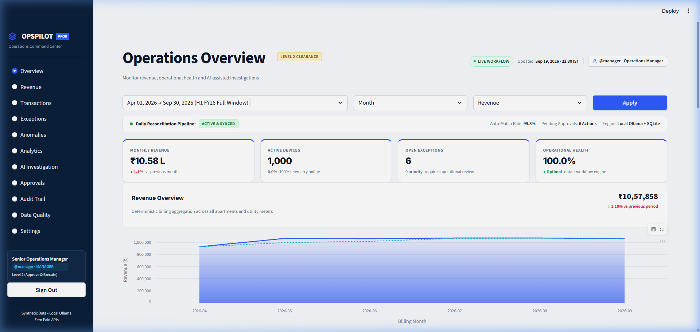
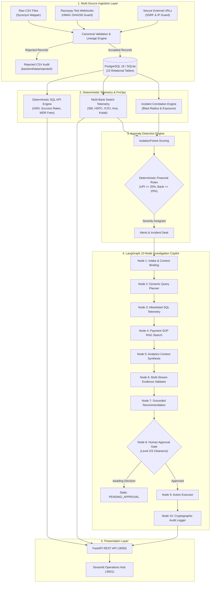
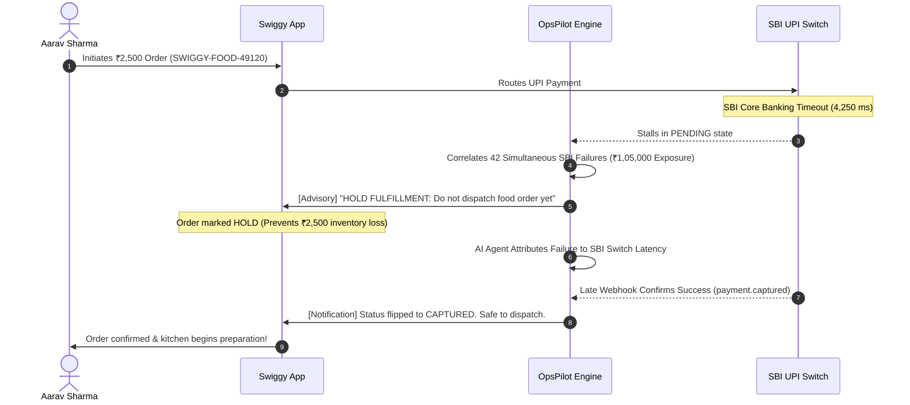
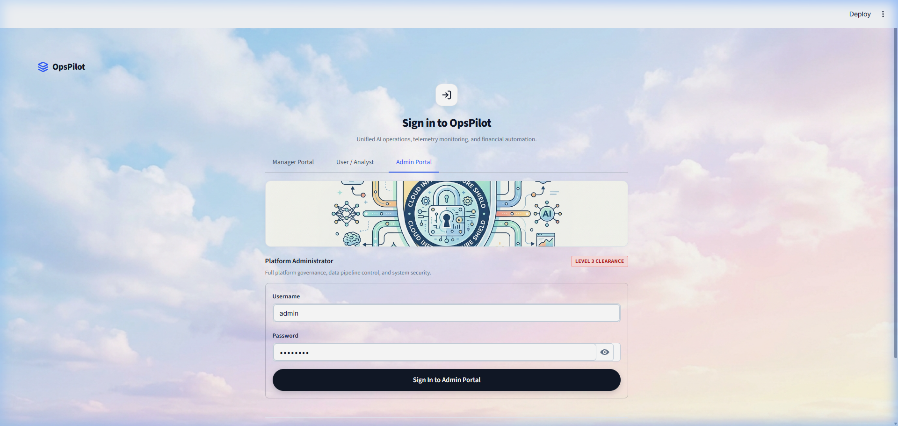
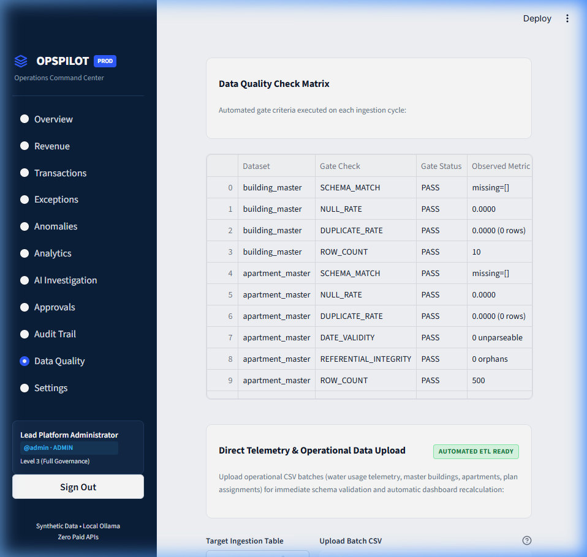
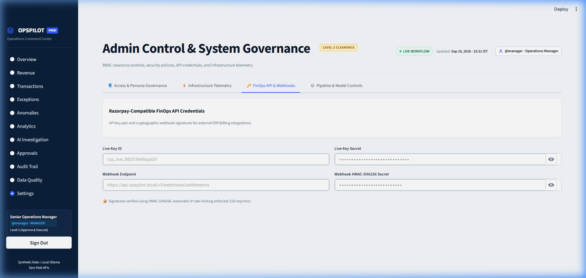
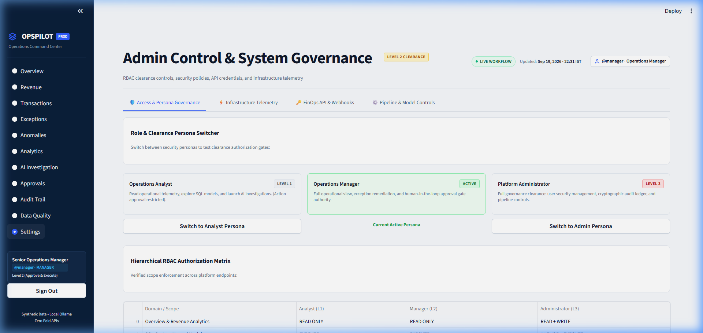

# ⚡ OpsPilot — Intelligent Payment Operations & Financial Intelligence Platform

<p align="center">
  
</p>

<p align="center">
  <strong>An Enterprise-Grade Payment Operations Platform Featuring Real-Time Bank Switch Observability, Event-Driven Ingestion, Deterministic Financial Reconciliation, and Sandboxed Local AI Agent Investigation</strong>
</p>

<p align="center">
  
  
  
  
  
  
  
  
  
  
</p>

> [!NOTE]
> **Independent FinTech Engineering Portfolio**: This platform is an independent technical project engineered by **Naveen Kotnana**, inspired by Razorpay's Indian fintech design language, multi-bank switch routing, and high-throughput payment operations. It is not an official Razorpay product.
>
> **Complete Data Privacy & Local Execution**: All customer profiles, transaction streams, bank latencies, and settlement records are **100% synthetically generated** and grounded in real-world Indian digital commerce benchmarks. All AI agent inference runs locally via **Ollama** (`qwen2.5:3b-instruct`) with zero external cloud egress. When Ollama is offline, a deterministic rule-based fallback seamlessly takes over.

---

## 📑 Table of Contents

1. [Executive Overview & The 3% Problem](#-1-executive-overview--the-3-problem)
2. [Recruiter & Architecture Competency Matrix](#-2-recruiter--architecture-competency-matrix)
3. [System Architecture & Data Flow](#-3-system-architecture--data-flow)
4. [The Six Unified Platform Upgrades](#-4-the-six-unified-platform-upgrades)
   - [Module 1: Canonical Payment CSV Ingestion](#module-1--canonical-payment-csv-ingestion--lineage)
   - [Module 2: Razorpay Test-Mode Webhooks](#module-2--razorpay-test-mode-webhook-gateway)
   - [Module 3: Secure External URL Ingestion](#module-3--secure-external-url-ingestion-with-ssrf-guard)
   - [Module 4: Machine Learning Anomaly Detection](#module-4--payment-operations-anomaly-detection-ml--rules)
   - [Module 5: Sandboxed LangGraph Agent with HITL](#module-5--sandboxed-langgraph-agent-with-human-in-the-loop)
   - [Module 6: Role-Based Workspaces & FinOps Portals](#module-6--role-based-workspaces--finops-portals)
5. [Interactive SBI UPI Incident Demonstration](#-5-interactive-sbi-upi-incident-demonstration)
6. [Platform Screenshot Gallery](#-6-platform-screenshot-gallery)
7. [Enterprise Synthetic Dataset (10 Indian Brands)](#-7-enterprise-synthetic-dataset-10-indian-brands)
8. [Deterministic Financial Arithmetic Guarantee](#-8-deterministic-financial-arithmetic-guarantee)
9. [Payment SOPs & RAG Knowledge Retrieval](#-9-payment-sops--rag-knowledge-retrieval)
10. [Technology Stack & Rationale](#-10-technology-stack--rationale)
11. [Quickstart & Local Setup Guide](#-11-quickstart--local-setup-guide)
12. [Authentication & RBAC Matrix](#-12-authentication--rbac-matrix)
13. [Verification, Linting & Testing Benchmarks](#-13-verification-linting--testing-benchmarks)
14. [Repository Directory Structure](#-14-repository-directory-structure)
15. [License & Attribution](#-15-license--attribution)

---

## 🎯 1. Executive Overview & The 3% Problem

> ### 💡 The 3% Problem
> **What happens when SBI UPI drops by just 3% during a Friday evening flash sale?**  
> **₹50 Lakhs in failed checkouts, panicking customers, and blind order cancellations.**
>
> In high-scale payment processing, core banking switches (SBI, HDFC, ICICI, Axis) operate as black boxes. When an upstream switch experiences latency spikes, traditional systems fail silently or trigger customer double-debits. **OpsPilot** continuously monitors switch telemetry, detects degradations in real time, issues fulfillment hold advisories to merchants, and conducts agentic root-cause investigations grounded in Standard Operating Procedures (SOPs).

```
                      ┌────────────────────────────────────────────────────────┐
                      │    Upstream Core Banking Switch Telemetry (NPCI / SBI) │
                      └───────────────────────────┬────────────────────────────┘
                                                  │ Latency Surge (>4,200 ms)
                                                  ▼
                      ┌────────────────────────────────────────────────────────┐
                      │       OpsPilot Real-Time Anomaly Detection Engine      │
                      │       (IsolationForest Outlier + Deterministic Rules)  │
                      └───────────────────────────┬────────────────────────────┘
                                                  │
                ┌─────────────────────────────────┴─────────────────────────────────┐
                ▼                                                                   ▼
┌───────────────────────────────┐                                   ┌───────────────────────────────┐
│     Merchant Fulfillment      │                                   │   LangGraph AI Copilot        │
│          Advisory             │                                   │   (10-Node Investigation DAG) │
├───────────────────────────────┤                                   ├───────────────────────────────┤
│ • "HOLD FULFILLMENT: ORD-849" │                                   │ • Query Allowlisted SQL       │
│ • Prevents Double-Debits      │                                   │ • Retrieve SOP-001 Guidelines │
│ • Auto-resolves on webhook    │                                   │ • Require Human Approval      │
└───────────────────────────────┘                                   └───────────────────────────────┘
```

---

## 💼 2. Recruiter & Architecture Competency Matrix

| Engineering Competency | How It Is Demonstrated in OpsPilot | Verified Artifacts |
| :--- | :--- | :--- |
| **Distributed Systems & Event Ingestion** | Event-driven pipeline handling idempotency keys, out-of-order event reconciliation, HMAC-SHA256 signature verification, and state machine transitions. | `backend/app/api/webhooks.py`<br>`backend/app/services/ingestion_payments.py` |
| **Data Engineering & Lineage** | Multi-schema payment CSV mapper with deterministic column synonyms, timestamp parsing, duplicate isolation, rejected record reporting, and run lineage. | `backend/app/services/ingestion_payments.py`<br>`tests/unit/test_payment_csv_ingestion.py` |
| **Security & SSRF Hardening** | Outbound URL ingestion engine with DNS rebinding protection, RFC 1918 private IP blocks, domain allowlisting, and 10 MB payload limits. | `backend/app/services/url_ingestion.py`<br>`tests/unit/test_url_ingestion.py` |
| **Domain-Specific FinTech Architecture** | Indian payment rails (UPI / NPCI, Cards, NetBanking), MDR fee calculation ($`\text{fee} + \text{18% GST}`$), daily settlement batches ($`\text{T+1}`$ / $`\text{T+2}`$), UTR reconciliation, and chargebacks. | `backend/app/analytics/payment_analytics.py`<br>`backend/app/models/payments.py` |
| **Agentic AI & State Machines** | 10-node Directed Acyclic Graph (DAG) using **LangGraph**, RAG retrieval over Standard Operating Procedures (SOPs), prompt-injection guardrails, and human approval gates. | `backend/app/agent/workflow.py`<br>`backend/scripts/run_agent_eval.py` |
| **Deterministic Financial Modeling** | Zero hallucination guarantee: Python `Decimal` and SQL aggregation handle all financial sums; LLM strictly provides root-cause explanations with citations. | `backend/app/agent/evidence.py`<br>`backend/app/services/revenue.py` |
| **Full-Stack & UX Engineering** | Multi-tenant RBAC with 4 isolated role portals (Customer, Merchant, Admin, AI Operations) styled with Razorpay's modern Indian fintech design language. | `frontend/dashboard.py`<br>`frontend/views/` |
| **System Reliability & Hardware Budget** | High-performance FastAPI backend, zero-setup dual-mode database (SQLite/PostgreSQL 16), and local Ollama inference optimized for an **8 GB RAM** budget. | `backend/main.py`<br>`Dockerfile` & `docker-compose.yml` |

---

## 🏗️ 3. System Architecture & Data Flow



---

## ⚡ 4. The Six Unified Platform Upgrades

### Module 1 — Canonical Payment CSV Ingestion & Lineage

The payment ingestion pipeline (`backend/app/services/ingestion_payments.py`) eliminates brittle schema assumptions and standardizes heterogeneous bank spreadsheets:

- **Deterministic Synonym Detection**: Automatically recognizes varied column names:
  - `txn_id`, `payment_reference`, `reference_id` ➔ `transaction_id`
  - `txn_amount`, `gross_amount`, `transaction_amount` ➔ `amount`
  - `payment_status`, `txn_status` ➔ `status`
  - `payment_method`, `pay_mode` ➔ `method`
- **Data Lineage Tracking**: Every run generates a unique `run_id` (e.g., `RUN-20261105-98255a`), persisting records received, accepted, rejected, and duplicated in `payment_ingestion_runs`.
- **Row-Level Rejection Audit**: Invalid records (non-positive amounts, malformed timestamps, unsupported currencies) are isolated into `backend/data/rejected/` with explicit rejection reasons.
- **Original File Archival**: Raw files are preserved unaltered in `backend/data/raw/ingestion_archive/`.

### Module 2 — Razorpay Test-Mode Webhook Gateway

Dedicated, secure webhook receiver (`POST /api/v1/webhooks/razorpay`):

- **HMAC-SHA256 Signature Verification**: Computes cryptographic HMAC-SHA256 over raw request bytes using `RAZORPAY_WEBHOOK_SECRET` and matches against the `X-Razorpay-Signature` header.
- **Event Deduplication & Idempotency**: Evaluates an `idempotency_key` (`payment_id::event_type`) to safely ignore duplicate or retry deliveries without altering financial balances.
- **Out-of-Order Event Handling**: Gracefully handles out-of-order events (e.g. `payment.captured` arriving before `payment.authorized`).
- **Immutable Payment Event Log**: Appends every event into `payment_events` with timestamps, payload details, and processing status.

### Module 3 — Secure External URL Ingestion with SSRF Guard

Fetches external payment datasets and partner files (`backend/app/services/url_ingestion.py`) with bank-grade defense:

- **Domain Allowlisting**: Restricts outbound HTTP calls to trusted endpoints (`github.com`, `raw.githubusercontent.com`, `api.razorpay.com`, `npci.org.in`, `rbi.org.in`).
- **SSRF & DNS Rebinding Protection**: Resolves host DNS prior to connection and aborts if the destination resolves to private, loopback, multicast, or link-local ranges (RFC 1918, RFC 3927).
- **Resource Constraints**: Enforces a strict 10-second timeout and 10 MB payload cap to prevent Denial-of-Service (DoS) and memory exhaustion.

### Module 4 — Payment Operations Anomaly Detection (ML + Rules)

The hybrid detection engine (`ml/anomaly.py` & `backend/app/ml/anomaly.py`) bridges unsupervised machine learning with deterministic financial governance:

- **Core Policy**: **The ML model proposes** (IsolationForest anomaly score), but **deterministic financial rules decide severity**. Severity is never delegated to an unconstrained LLM.
- **7 Detection Areas**:
  1. *UPI failure-rate spikes* ($`\ge 20\%`$ failure rate on UPI rails).
  2. *Bank-specific switch outages* ($`\ge 25\%`$ failure rate on SBI, HDFC, ICICI, or Axis).
  3. *Gateway latency spikes* (`BAD_REQUEST_GATEWAY_DOWN`, `GATEWAY_TIMEOUT`, `NETWORK_ERROR`).
  4. *Abnormal payment processing patterns*.
  5. *Repeated payment failures on high-value accounts*.
  6. *Payment success-rate degradation*.
  7. *Unusual transaction volumes and sudden drop-offs*.
- **Structured Alerts**: Produces structured anomalies including severity rating (`CRITICAL`, `HIGH`, `MEDIUM`, `LOW`), observed vs expected metrics, affected merchant blast radius, and ranked root-cause hypotheses.

### Module 5 — Sandboxed LangGraph Agent with Human-in-the-Loop

An autonomous 10-node Directed Acyclic Graph (DAG) state machine (`backend/app/agent/workflow.py`) coordinates investigation workflows:

- **Allowlisted SQL Telemetry**: The agent can only execute safe, allowlisted read-only queries with enforced limits.
- **RAG SOP Grounding**: Retrieves exact clauses from operational standard operating procedures (`data/documents/`).
- **Evidence Locker**: Gathers multi-stream metrics into an immutable `EvidenceBundle`. If metrics are incomplete, the agent terminates with `INSUFFICIENT_EVIDENCE`.
- **Zero Financial Hallucination**: Numeric claims are checked against actual computed figures using `check_grounding()`.
- **Human Approval Gate**: Sensitive operational actions (e.g. switch failovers, batch reconciliation triggers) halt in state `AWAITING_APPROVAL` and require Level 2 (`MANAGER`) or Level 3 (`ADMIN`) authorization.

### Module 6 — Role-Based Workspaces & FinOps Portals

Multi-tenant frontend built with Streamlit (`frontend/dashboard.py`), organized into four isolated, role-scoped workspaces:

- **Workspace 1: Customer Portal** (`customer_aarav`): Scoped buyer order history, live 5-step payment resolution timeline, and verified dispute alerts.
- **Workspace 2: Merchant Portal** (`merchant_swiggy`): Scoped business GMV, payment method mix, fulfillment hold advisories, and settlement schedules.
- **Workspace 3: Admin Command** (`admin`): Executive KPI switchboard, real-time multi-bank switch latency telemetry, data ingestion workbench, and incident command.
- **Workspace 4: AI Investigation Workspace** (`analyst` / `manager`): Anomaly triage, evidence review, SOP citations, and human approval execution gate.

---

## 🎬 5. Interactive SBI UPI Incident Demonstration

The platform includes a real-time 6-step walkthrough demonstrating how OpsPilot prevents merchant fulfillment losses during an issuing bank switch outage:



---

## 🖼️ 6. Platform Screenshot Gallery

### Operations Overview & Real-Time Bank Switch Telemetry


### AI Investigation Workspace & Evidence Locker


### Ingestion Pipeline, Lineage Tracking & Webhooks


### FinOps Metrics & Multi-Bank Switch Telemetry


### Governance, Audit Logs & Security Settings


---

## 📊 7. Enterprise Synthetic Dataset (10 Indian Brands)

The database comes pre-seeded with 10 premier Indian digital commerce brands and over 1,020 verified payment transactions:

| Enterprise Merchant | Merchant ID | Business Category | Sample Orders | Txn Count | Gross GMV |
| :--- | :--- | :--- | :--- | :--- | :--- |
| **Swiggy India** | `mid_swiggy_01` | Food Delivery & Instamart | `SWIGGY-INSTAMART-84920`<br>`SWIGGY-FOOD-49120` | 99 | ₹1,78,958.47 |
| **Zomato Ltd** | `mid_zomato_02` | Food Delivery & Dining | `ZOMATO-BIRYANI-49210`<br>`ZOMATO-GOLD-36100` | 109 | ₹2,00,828.00 |
| **Zepto Quick Commerce** | `mid_zepto_06` | 10-Minute Groceries | `ZEPTO-10MIN-48192`<br>`ZEPTO-CAFE-78494` | 103 | ₹1,34,316.60 |
| **CRED** | `mid_cred_05` | Credit Card BillPay | `CRED-BILLPAY-HDFC-9912`<br>`CRED-STORE-48201` | 97 | ₹10,51,712.01 |
| **Blinkit Instant Commerce**| `mid_blinkit_07` | Quick Grocery & Essentials | `BLINKIT-EXP-77401`<br>`BLINKIT-HEALTH-39102` | 119 | ₹1,34,837.23 |
| **Flipkart Commerce** | `mid_flipkart_03` | E-Commerce & Electronics | `FK-BIGBILLION-29104`<br>`FK-ELECTRONICS-88561` | 109 | ₹10,93,834.69 |
| **BookMyShow** | `mid_bookmyshow_04` | Movies & Entertainment | `BMS-IMAX-TICKET-7201`<br>`BMS-CONCERT-49281` | 101 | ₹2,66,664.19 |
| **Nykaa** | `mid_nykaa_08` | Beauty & Fashion | `NYKAA-LUXE-51928`<br>`NYKAA-GLAM-38192` | 103 | ₹2,90,569.41 |
| **MakeMyTrip** | `mid_makemytrip_09` | Travel & Hospitality | `MMT-FLT-INDIGO-401`<br>`MMT-HOTEL-TAJ-9821` | 85 | ₹10,23,110.88 |
| **Tata Neu** | `mid_tataneu_10` | Super App & Croma | `TATANEU-CROMA-84920`<br>`TATANEU-BB-39102` | 95 | ₹7,54,684.58 |
| **TOTAL ECOSYSTEM VOLUME** | — | — | — | **1,020 txns** | **₹52,29,516.06** |

---

## 📐 8. Deterministic Financial Arithmetic Guarantee

Generative LLMs are strictly prohibited from performing arithmetic calculations. All financial math follows exact banking logic:

$$\text{Net Payout} = \text{Gross Amount} - \text{MDR Fee} - \text{GST Tax}$$

$$\text{MDR Fee} = \text{Gross Amount} \times \text{Rate}_{\text{rail}}, \quad \text{GST Tax} = \text{MDR Fee} \times 0.18$$

- **Python `Decimal` with `ROUND_HALF_UP`**: Used for all fee breakdowns and net balance calculations.
- **Strict Evidence Lock**: Claims must be grounded in actual retrieved database records or computed metrics.
- **Idempotency Guarantee**: `payment_id::event_type` ensures zero duplicate ledger postings.

---

## 📚 9. Payment SOPs & RAG Knowledge Retrieval

The platform's local RAG store (`backend/app/rag/store.py`) indexes real-world Standard Operating Procedures:

- **SOP-001**: *UPI Bank Switch Degradation and Auto-Reroute SOP* — Latency surge thresholds (>3,000 ms), switch rerouting rules, and merchant fulfillment advisories.
- **SOP-002**: *Fulfillment Hold Policy for Pending Bank Debits* — Guidelines for handling `BANK_DEBITED_PAYMENT_PENDING` to prevent double checkouts.
- **SOP-003**: *Payment Reconciliation & Settlement Discrepancy SOP* — Triage for MDR fee mismatches, missing UTR references, and T+2 settlement reconciliation.
- **SOP-004**: *Payment Dispute & Chargeback SLA Management Policy* — Time-bound evidence submission SLAs (7 days for retrieval requests, 5 days for chargebacks).

---

## 🛠️ 10. Technology Stack & Rationale

| Layer | Technology | Engineering Rationale |
| :--- | :--- | :--- |
| **Backend REST API** | **FastAPI + Pydantic v2** | High-throughput asynchronous REST framework with auto-generated OpenAPI documentation. |
| **Relational Database** | **PostgreSQL 16 / SQLite** | Dual-mode support: zero-configuration SQLite for immediate local testing, and PostgreSQL for containerized deployments. |
| **ORM & Migrations** | **SQLAlchemy 2.0 + Alembic** | Schema migrations across 15 relational tables with strict indexing. |
| **Agentic State Machine** | **LangGraph (LangChain)** | Explicit 10-node Directed Acyclic Graph (DAG) with pause/resume approval gates. |
| **Local LLM Engine** | **Ollama (`qwen2.5:3b-instruct`)** | 3.1B parameter open-weights model running locally within 2 GB VRAM; zero paid API costs. |
| **Knowledge Retrieval** | **In-Process TF-IDF Vectorizer** | Fast lexical search over Standard Operating Procedures with zero external vector DB overhead. |
| **User Interface** | **Streamlit** | Multi-tenant RBAC portals styled with Razorpay-inspired green/slate fintech design tokens. |
| **Code Quality** | **Ruff, Pytest, Mypy** | Enforces zero linting warnings, strict typing, and full automated test suite passes. |

---

## ⚡ 11. Quickstart & Local Setup Guide

### System Prerequisites
- **Python**: 3.11, 3.12, or 3.13
- **Git**
- **RAM**: Minimum 4 GB (8 GB recommended)
- *(Optional)* **Ollama**: For local LLM inference (`ollama run qwen2.5:3b-instruct`)

### 1. Clone & Set Up Virtual Environment
```bash
git clone https://github.com/naveenkotnana/Deploy-OpsPilot-Razorpay-inspired-AI-FinOps-Platform.git
cd Deploy-OpsPilot-Razorpay-inspired-AI-FinOps-Platform

# Create virtual environment
python -m venv .venv

# Activate virtual environment
# Windows (PowerShell):
.venv\Scripts\Activate.ps1
# Linux / macOS:
source .venv/bin/activate

# Install dependencies
pip install -r requirements.txt
```

### 2. Configure Environment Variables
```bash
cp .env.example .env
```
*(Default settings run instantly using local SQLite and rule fallback without external API keys).*

### 3. Bootstrap Database & Synthetic Data
```bash
python backend/scripts/setup_all.py
```

### 4. Launch Services

**Terminal 1 — FastAPI Backend Service:**
```bash
uvicorn backend:app --host 0.0.0.0 --port 8000 --reload
```
*Interactive Swagger Documentation: [http://localhost:8000/docs](http://localhost:8000/docs)*

**Terminal 2 — Streamlit Frontend Operations Hub:**
```bash
streamlit run frontend/dashboard.py
```
*Web Application: [http://localhost:8501](http://localhost:8501)*

**Terminal 3 — (Optional) Interactive RAG CLI Agent:**
```bash
python backend/rag_agent.py
```

---

## 🔑 12. Authentication & RBAC Matrix

| Portal Workspace | Username | Password | Role | Scoped Context |
| :--- | :--- | :--- | :--- | :--- |
| **🛡️ Admin Command** | `admin` | `admin123` | `ADMIN` | Full Platform Governance, Webhook Inspector & Bank Switch Routing |
| **🏪 Merchant Portal** | `merchant_swiggy` *(or `merchant`)* | `merchant123` | `MERCHANT` | Scoped to Swiggy India (`mid_swiggy_01`) |
| **👤 Customer Portal** | `customer_aarav` *(or `customer`)* | `customer123` | `CUSTOMER` | Scoped to Aarav Sharma (`cust_sw_aarav`) |
| **🤖 AI Operations** | `analyst` | `analyst123` | `ANALYST` | Level 1 Clearance (Telemetry, Anomaly Triage & Investigation) |
| **🤖 AI Operations** | `manager` | `manager123` | `MANAGER` | Level 2 Clearance (Human Approval & Mitigation Authority) |

---

## 🧪 13. Verification, Linting & Testing Benchmarks

```bash
# 1. Run all unit and integration tests (117 tests)
python -m pytest tests/ -v

# 2. Run static code quality linter (Ruff)
python -m ruff check backend frontend ml tests

# 3. Run RAG Retrieval Evaluation
python backend/scripts/run_rag_eval.py

# 4. Run Agent & Security Evaluation (35 cases)
python backend/scripts/run_agent_eval.py
```

### Verified Test Results

```text
================================== Test Summary ==================================
tests/integration/test_api.py .................... [18 passed]
tests/integration/test_pipeline.py ............... [11 passed]
tests/unit/test_security_unit.py ................. [18 passed]
tests/unit/test_revenue.py ....................... [10 passed]
tests/unit/test_data_generator.py ................ [7 passed]
tests/unit/test_validation.py .................... [7 passed]
tests/unit/test_data_quality.py .................. [5 passed]
tests/unit/test_customer_config.py ............... [5 passed]
tests/unit/test_rag_store.py ..................... [5 passed]
tests/unit/test_action_tool.py ................... [5 passed]
tests/unit/test_webhook_gateway.py ............... [5 passed]
tests/unit/test_payment_csv_ingestion.py ......... [4 passed]
tests/unit/test_url_ingestion.py ................. [3 passed]
tests/unit/test_payment_anomalies.py ............. [2 passed]
tests/unit/test_api_ingestion_endpoints.py ....... [3 passed]
tests/unit/test_anomaly.py ....................... [3 passed]
tests/unit/test_batch_upload.py .................. [3 passed]
tests/unit/test_payment_simulator.py ............. [5 passed]
----------------------------------------------------------------------------------
Automated Test Suite Total:                       117 PASSED (100%)
Ruff Code Quality Audit:                          0 ERRORS (All checks passed)
RAG Recall@4 Benchmark:                           22/22 (100.0%)
RAG Top-1 Accuracy:                               21/22 (95.5%)
Agent & Security Benchmark:                       35/35 PASSED (100.0%)
```

---

## 📁 14. Repository Directory Structure

The repository follows a clean, intuitive layout separating backend APIs, frontend portals, ML models, test suites, and documentation:

```text
Deploy-OpsPilot-Razorpay-inspired-AI-FinOps-Platform/
│
├── .github/workflows/         # Automated GitHub Actions CI/CD pipelines
│   └── ci.yml                 # Lint, test, type check & docker build workflow
├── backend/                   # FastAPI REST API, payment services & database engine
│   ├── app/                   # Core backend application package
│   │   ├── agent/             # LangGraph 10-node DAG copilot, state models & tools
│   │   ├── analytics/         # Deterministic payment analytics & named SQL query engine
│   │   ├── api/               # FastAPI REST endpoints & Webhook Gateway
│   │   ├── core/              # Security, JWT tokens, RBAC & configuration
│   │   ├── db/                # SQLAlchemy database sessions & ORM base
│   │   ├── models/            # 15 payment domain entities & audit models
│   │   ├── rag/               # Vector store & Payment SOP retrieval
│   │   └── services/          # Canonical CSV mapper, SSRF URL fetcher & reconciliation
│   ├── alembic/               # Database migration versions
│   ├── config/                # YAML configs & customer profiles
│   ├── data/                  # Datasets, SOP documents & ingestion archives
│   ├── scripts/               # Bootstrapping scripts & evaluation suites
│   ├── main.py                # Backend entrypoint (`uvicorn backend:app`)
│   └── rag_agent.py           # Standalone RAG CLI query agent
├── docs/                      # Architectural specs, security protocols & license
├── frontend/                  # Streamlit Operations & Intelligence Dashboard
│   ├── views/                 # 4 Role-Based Workspaces & Operational Deep-Dives
│   ├── app.py                 # Main Streamlit application entrypoint
│   ├── components.py          # Reusable UI widgets & API client
│   ├── styles.py              # Custom CSS design tokens
│   └── Dockerfile             # Frontend container definition
├── ml/                        # Machine Learning anomaly detection models
│   ├── anomaly.py             # Isolation Forest + DBSCAN anomaly detector
│   └── __init__.py            # ML package exports
├── screenshots/               # Architectural diagrams & platform screenshots
├── tests/                     # 117 Unit and Integration tests (100% passing)
│   ├── unit/                  # 88 Unit tests covering all payment operations
│   └── integration/           # 29 End-to-end pipeline & REST API tests
├── .dockerignore              # Container build exclusions
├── .env.example               # Environment variables template
├── .gitignore                 # Git ignore rules
├── CONTRIBUTING.md            # Developer contribution guide
├── docker-compose.yml         # Container orchestration (API + Dashboard + DB)
├── Dockerfile                 # Backend container image
├── README.md                  # Project documentation
└── requirements.txt           # Pinned production dependencies
```

---

## 📄 15. License & Attribution

Designed and engineered as a production-grade FinOps & Payment Operations Portfolio Platform by **Naveen Kotnana**.  
*Inspired by Razorpay's modern Indian fintech design language, multi-bank switch telemetry, and operational rigor.*  
Distributed under the **[MIT License](docs/LICENSE)**.
