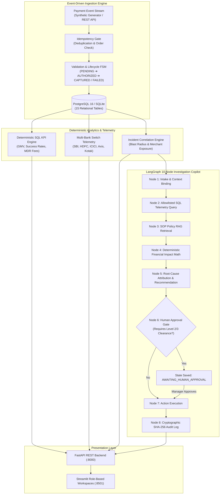

# ⚡ Razorpay-Inspired AI Payments — Intelligent Payment Operations & Financial Intelligence Platform

<p align="center">
  
</p>

<p align="center">
  <strong>An Enterprise-Grade Payment Operations Platform Featuring Real-Time Bank Switch Observability, Event-Driven Ingestion, Deterministic Financial Reconciliation, and Sandboxed Local AI Agent Investigation</strong>
</p>

<p align="center">
  
  
  
  
  
  
  
  
  
  
</p>

> [!NOTE]
> **Independent Portfolio Showcase**: This platform is an independent technical portfolio project engineered by **Naveen Kotnana**, inspired by Razorpay's Indian fintech design language, multi-bank switch routing, and high-throughput payment operations. It is **not** an official Razorpay product.
> 
> **Zero Paid API Overhead & Complete Data Privacy**: All customer profiles, transaction streams, bank latencies, and settlement records are **100% synthetically generated** and grounded in real-world Indian digital commerce benchmarks. All AI agent inference runs locally via **Ollama** (`qwen2.5:3b-instruct`) with zero external cloud egress. When Ollama is offline, a deterministic rule-based fallback seamlessly takes over.

---

## 🎯 Executive Overview & Engineering Pitch

> ### 💡 The 3% Problem
> **What happens when SBI UPI drops by just 3% during a Friday evening flash sale?**  
> **₹50 Lakhs in failed checkouts, panicking customers, and blind order cancellations.**
>
> When high-scale payment gateways process millions of transactions across heterogeneous core banking switches, even minor upstream latency surges trigger catastrophic merchant fulfillment holds. This platform demonstrates how to build an **autonomous payment operations and financial intelligence engine** that detects switch degradations in real time, alerts merchants to pause fulfillment, and automates root-cause investigations with zero-hallucination deterministic math.

In modern digital economies, payment aggregators handle billions of rupees across heterogeneous issuing bank switches (SBI, HDFC, ICICI, Axis, Kotak) and payment rails (UPI, Credit/Debit Cards, Net Banking, Wallets). When an issuing bank switch degrades, even a **1.5% drop in success rate** translates to tens of lakhs in failed transactions, merchant panic, customer double-debit confusion, and erroneous order fulfillment holds.

**Razorpay-Inspired AI Payments** bridges the gap between raw database transactions and operational financial intelligence:
1. **Real-Time Bank Switch Telemetry**: Distinguishes upstream Core Banking switch timeouts from gateway aggregator drops and customer drop-offs.
2. **Order Fulfillment Advisories**: Real-time webhook guards advising merchants to hold fulfillment for pending payments until final bank verification is established.
3. **Deterministic Math & Zero Financial Hallucination**: Generative LLMs **never** perform financial calculations. All fee structures, MDRs, GST taxes, net payouts, and blast radiuses execute strictly via SQL window functions and Python `Decimal(ROUND_HALF_UP)`.
4. **Sandboxed AI Investigation Copilot**: A 10-node **LangGraph state machine** inspects allowlisted SQL queries, cross-references Standard Operating Procedures (SOPs), calculates exposure, and stops at an explicit human approval gate before triggering high-impact operational mitigations.
5. **Real-World Enterprise Scale**: Pre-seeded with 10 premier Indian digital commerce brands (**Swiggy**, **Zomato**, **Zepto**, **CRED**, **Blinkit**, **Flipkart**, **BookMyShow**, **Nykaa**, **MakeMyTrip**, **Tata Neu**) and 600+ authentic customer profiles.

---

## 💼 Recruiter & Hiring Manager Highlights

| Engineering Competency | How It Is Demonstrated in This Project |
| :--- | :--- |
| **Distributed Systems & Event Ingestion** | Event-driven pipeline handling idempotency keys, out-of-order event reconciliation, state transition validation (FSM), and deduplication. |
| **Domain-Specific Fintech Architecture** | Indian payment rails (UPI / NPCI, Cards, NetBanking), MDR fee calculation ($`\text{fee} + \text{18% GST}`$), daily settlement batches ($`\text{T+1}`$ / $`\text{T+2}`$), UTR reconciliation, and chargebacks. |
| **Agentic AI & State Machines** | 10-node Directed Acyclic Graph (DAG) using **LangGraph**, RAG retrieval over Standard Operating Procedures (SOPs), prompt-injection guardrails, and human approval gates. |
| **Deterministic Financial Modeling** | Zero hallucination guarantee: Python `Decimal` and SQL aggregation handle all financial sums; LLM strictly provides root-cause explanations with citations. |
| **Full-Stack & UX Engineering** | Multi-tenant RBAC with 4 isolated role portals (Customer, Merchant, Admin, AI Operations) styled with Razorpay's modern Indian fintech design language. |
| **System Reliability & Hardware Budget** | High-performance FastAPI backend, zero-setup dual-mode database (SQLite/PostgreSQL 16), and local Ollama inference optimized for an **8 GB RAM** budget. |

---

## 📑 Table of Contents
1. [Role-Based Workspaces & Architecture](#-1-role-based-workspaces--architecture)
2. [Interactive SBI UPI Live Demonstration](#-2-interactive-sbi-upi-live-demonstration)
3. [System Architecture & Ingestion Pipeline](#-3-system-architecture--ingestion-pipeline)
4. [Real-World Enterprise Dataset (500+ Indian Profiles)](#-4-real-world-enterprise-dataset-500-indian-profiles)
5. [Deterministic Financial Math & Strict Evidence Rules](#-5-deterministic-financial-math--strict-evidence-rules)
6. [Machine Learning & Anomaly Detection](#-6-machine-learning--anomaly-detection)
7. [Technology Stack & Rationale](#-7-technology-stack--rationale)
8. [Quickstart & Local Setup Guide](#-8-quickstart--local-setup-guide)
9. [Default Authentication Credentials (RBAC Matrix)](#-9-default-authentication-credentials-rbac-matrix)
10. [Synthetic Scenario Engine & Augmentation](#-10-synthetic-scenario-engine--augmentation)
11. [Verification, Linting & Testing Suites](#-11-verification-linting--testing-suites)
12. [Repository Structure](#-12-repository-structure)
13. [License & Attribution](#-13-license--attribution)

---

## 🏢 1. Role-Based Workspaces & Architecture

The application enforces strict role-based navigation where each authenticated user accesses only their authorized view:

```
                            ┌─────────────────────────────────────────┐
                            │    Fintech Authentication Gateway       │
                            │      (Multi-Role Portal Selector)       │
                            └────────────────────┬────────────────────┘
                                                 │
         ┌───────────────────────┬───────────────┴───────────────┬───────────────────────┐
         ▼                       ▼                               ▼                       ▼
┌──────────────────┐   ┌───────────────────┐           ┌───────────────────┐   ┌───────────────────┐
│   Workspace 1    │   │    Workspace 2    │           │    Workspace 3    │   │    Workspace 4    │
│ Customer Portal  │   │  Merchant Portal  │           │  Admin Dashboard  │   │ AI Investigation  │
│  (Aarav Sharma)  │   │  (Swiggy India)   │           │ (Platform Admin)  │   │ (FinOps Analyst)  │
├──────────────────┤   ├───────────────────┤           ├───────────────────┤   ├───────────────────┤
│• Customer Home   │   │• Merchant Overview│           │• Executive Overview│  │• Anomaly Triage   │
│• My Transactions │   │• Scoped Txn Stream│           │• Payment Monitoring│  │• Evidence Locker  │
│• 5-Step Timeline │   │• Fulfillment Alerts│          │• Bank Switch Health│  │• Root-Cause Citations│
│• Verified Alerts │   │• Bank SR Slicing  │           │• Incident Command │  │• Human Approvals  │
│                  │   │• UTR Settlements  │           │• Pipeline Telemetry│  │• Audit Logging    │
└──────────────────┘   └───────────────────┘           └───────────────────┘   └───────────────────┘
```

### Workspace 1: Customer Portal (`/customer` | `customer_aarav`)
- **Customer Home**: Financial summary card showing total spend, successful charges, pending bank confirmations, and recent orders.
- **My Transactions**: Scoped personal transaction history with real-time status chips and error codes.
- **5-Step Payment Verification Timeline**: Visual audit trail tracking:
  `Payment Initiated` ➔ `Issuing Bank Response` ➔ `Gateway Hub Verification` ➔ `Final Verified State` ➔ `Refund Status (if applicable)`.
- **Evidence-Backed Notifications**: Clean, transparent customer updates. *Strict policy: Never informs a customer that funds were debited or refunded unless ledger evidence confirms it.*

### Workspace 2: Merchant Portal (`/merchant` | `merchant_swiggy`)
- **Merchant Overview**: Gross Merchandise Value (GMV), Success Rate %, Pending Verification Count, and Net Payout.
- **Transactions Stream**: Live stream with transaction ID, customer reference, MDR fee, GST tax, and net payout.
- **Fulfillment Hold Advisories**: Real-time alerts when bank confirmation webhooks are delayed, advising merchants to pause delivery dispatch to prevent double payments.
- **Payment Analytics**: Payment rails breakdown (UPI vs Card vs Net Banking) and bank-wise success rate slicing.
- **Settlement Overview**: Daily disbursement batches, Bank UTR reference tracking, and discrepancy resolution.

### Workspace 3: Admin Command Center (`/admin` | `admin`)
- **Executive Overview**: Total platform GMV, success/failure rates, gateway distribution, and active blast radius.
- **Payment Monitoring**: High-volume transaction feed with filters for Payment ID, Merchant, Bank, and Gateway.
- **Bank Switch Telemetry**: Live telemetry across SBI, HDFC, ICICI, Axis, and Kotak with root-cause attribution (`BANK_CORE_SWITCH_TIMEOUT`, `GATEWAY_TIMEOUT`, `CUSTOMER_DECLINE`).
- **Incident Command Centre**: Active payment incidents, affected merchant impact, estimated financial exposure in INR, and resolution lifecycle.
- **Merchants & Customers Directory**: Unified directory with risk tiers, settlement cycles, and customer profiles.
- **Data Pipeline & Event Telemetry**: Real-time event counter, payment attempt logs, and deduplication stats.
- **Cryptographic Audit Trail**: Immutable SHA-256 audit ledger with execution latency, tool names, and human approval timestamps.

### Workspace 4: AI Investigation Workspace (`/ai-investigation` | `analyst`)
- **Structured Investigation**: Evaluates incident telemetry across 7 deterministic sections:
  1. *Incident Summary*
  2. *Grounded Telemetry Evidence (SQL Queries & Bank Latencies)*
  3. *Ranked Root Causes (Probabilistic Hypotheses)*
  4. *Affected Transaction Stream*
  5. *Merchant Financial Exposure ($`\Sigma \text{Failed Amounts}`$)*
  6. *Recommended Mitigation Actions*
  7. *Confidence Score & Analysis Limitations*
- **Human Approval Gate**: Intercepts high-impact actions (switch reroutes, bulk retries, merchant freezes) and requires explicit clearance before execution.

---

## 🎬 2. Interactive SBI UPI Live Demonstration

The platform includes a 6-step interactive walkthrough that mirrors a real-world payment incident:

```
[Step 1: Payment Initiated] ──> Aarav Sharma initiates ₹2,500 food order on Swiggy via SBI UPI.
         │
[Step 2: Delayed Bank Webhook] ─> SBI Core Banking timeout causes transaction to stall in PENDING.
         │
[Step 3: Fulfillment Hold] ───> Swiggy dashboard receives advisory: "Do not dispatch order yet".
         │
[Step 4: Incident Clustering] ──> System correlates 42 simultaneous SBI failures; flags ₹1,05,000 exposure.
         │
[Step 5: AI Root Cause] ───────> Agent attributes failure to SBI Core Switch latency (4,250 ms vs 450 ms).
         │
[Step 6: Verified Resolution] ──> Webhook resolves, status flips to CAPTURED, order is safely fulfilled.
```

---

## 🏗️ 3. System Architecture & Ingestion Pipeline



---

## 📊 4. Real-World Enterprise Dataset (500+ Indian Profiles)

To provide an authentic fintech demonstration without breaching proprietary client data, the platform generates and maintains a comprehensive real-world dataset representing India's leading digital brands:

| Enterprise Merchant | Business Category | Sample Order Receipts | Volume | Gross Value |
| :--- | :--- | :--- | :--- | :--- |
| **Swiggy India** (`mid_swiggy_01`) | Food Delivery & Instamart | `SWIGGY-INSTAMART-84920`<br>`SWIGGY-FOOD-49120` | 99 txns | ₹1,78,958.47 |
| **Zomato Ltd** (`mid_zomato_02`) | Food Delivery & Dining | `ZOMATO-BIRYANI-49210`<br>`ZOMATO-GOLD-36100` | 109 txns | ₹2,00,828.00 |
| **Zepto Quick Commerce** (`mid_zepto_06`) | 10-Minute Groceries | `ZEPTO-10MIN-48192`<br>`ZEPTO-CAFE-78494` | 103 txns | ₹1,34,316.60 |
| **Dreamplug Technologies (CRED)** (`mid_cred_05`) | FinTech & Credit Card BillPay | `CRED-BILLPAY-HDFC-9912`<br>`CRED-STORE-48201` | 97 txns | ₹10,51,712.01 |
| **Blinkit Instant Commerce** (`mid_blinkit_07`) | Quick Grocery & Essentials | `BLINKIT-EXP-77401`<br>`BLINKIT-HEALTH-39102` | 119 txns | ₹1,34,837.23 |
| **Flipkart Commerce** (`mid_flipkart_03`) | E-Commerce & Electronics | `FK-BIGBILLION-29104`<br>`FK-ELECTRONICS-88561` | 109 txns | ₹10,93,834.69 |
| **BookMyShow Ticketing** (`mid_bookmyshow_04`) | Movies & Entertainment | `BMS-IMAX-TICKET-7201`<br>`BMS-CONCERT-49281` | 101 txns | ₹2,66,664.19 |
| **FSN E-Commerce (Nykaa)** (`mid_nykaa_08`) | Beauty & Fashion | `NYKAA-LUXE-51928`<br>`NYKAA-GLAM-38192` | 103 txns | ₹2,90,569.41 |
| **MakeMyTrip India** (`mid_makemytrip_09`) | Travel & Hospitality | `MMT-FLT-INDIGO-401`<br>`MMT-HOTEL-TAJ-9821` | 85 txns | ₹10,23,110.88 |
| **Tata Digital (Tata Neu)** (`mid_tataneu_10`) | Super App & Croma | `TATANEU-CROMA-84920`<br>`TATANEU-BB-39102` | 95 txns | ₹7,54,684.58 |
| **TOTAL SYNTHESIZED PLATFORM VOLUME** | — | — | **1,020 txns** | **₹52,29,516.06** |

### Exported Datasets
- **[data/raw/fintech_customers_500plus.csv](file:///d:/Deploy-OpsPilot-Razorpay-inspired-AI-FinOps-Platform/data/raw/fintech_customers_500plus.csv)**: 600 unique Indian customer profiles with authentic names, phone numbers, cities, PIN codes, banks, KYC statuses, and spend histories.
- **[data/raw/fintech_transactions_500plus.csv](file:///d:/Deploy-OpsPilot-Razorpay-inspired-AI-FinOps-Platform/data/raw/fintech_transactions_500plus.csv)**: 600 verified transactions linking customers to merchants with deterministic fee/tax breakdowns.

---

## 📐 5. Deterministic Financial Math & Strict Evidence Rules

A fundamental design requirement of this platform is **zero financial hallucination**:

1. **Deterministic Decimal Arithmetic**: LLMs are strictly forbidden from performing mathematical calculations or currency additions. All gross volumes, MDR processing fees, GST taxes, net payouts, and incident financial exposures are calculated using Python `Decimal` with `ROUND_HALF_UP` or direct SQL aggregation:
   $$\text{Net Payout} = \text{Gross Amount} - \text{MDR Fee} - \text{GST Tax}$$
   $$\text{MDR Fee} = \text{Gross Amount} \times \text{Rate}_{\text{rail}}, \quad \text{GST Tax} = \text{MDR Fee} \times 0.18$$
2. **Strict Evidence Rules**:
   - The AI Copilot never invents unobserved transactions or imaginary error codes.
   - If telemetry data is insufficient, the system explicitly reports **"Insufficient Telemetry"** and notes the limitations.
   - Customers are never informed that funds were debited or refunded unless verified by a corresponding ledger record.
3. **Idempotent Ingestion**: Every payment event carries a unique idempotency key (`payment_id::event_type`). Duplicate events are acknowledged without duplicating financial balances.

---

## 🤖 6. Machine Learning & Anomaly Detection

- **Unsupervised Anomaly Detection**: Uses scikit-learn's `IsolationForest` to analyze multi-dimensional transaction features (failure rate deltas, latency spikes, refund ratio anomalies).
- **Temporal Integrity**: The training, validation, and test split follows a strict chronological boundary (`train_cutoff_time`, `val_cutoff_time`) to prevent time-series data leakage.
- **Rule-Based Severity Thresholds**:
  - `CRITICAL`: Success rate drop $> 25\%$ or financial exposure $> ₹1,00,000$.
  - `HIGH`: Success rate drop $> 15\%$ or sustained latency $> 3,000\text{ ms}$.
  - `MEDIUM`: Latency degradation between $1,500\text{ ms}$ and $3,000\text{ ms}$.
  - `LOW`: Minor deviations within expected operational tolerance.

---

## 🛠️ 7. Technology Stack & Rationale

| Layer | Technology | Engineering Rationale |
| :--- | :--- | :--- |
| **Backend API** | **FastAPI + Pydantic v2** | Asynchronous, typed REST framework with auto-generated OpenAPI Swagger documentation. |
| **Database** | **PostgreSQL 16 / SQLite** | Dual-mode support: zero-configuration SQLite for immediate local testing, and PostgreSQL for production. |
| **ORM & Migrations** | **SQLAlchemy 2.0 + Alembic** | Schema migrations across 15 relational tables with relationships and indexes. |
| **Agentic State Machine**| **LangGraph (LangChain)** | Explicit Directed Acyclic Graph (DAG) state machine with pause/resume approval gates. |
| **Local LLM Engine** | **Ollama (`qwen2.5:3b-instruct`)** | 3.1B parameter open-weights model running locally within 2 GB VRAM; zero paid API costs. |
| **Knowledge Retrieval** | **In-Process TF-IDF Vectorizer** | Zero-memory lexical search over Standard Operating Procedures (SOPs). Recall@4 = 1.000 without requiring heavy vector databases. |
| **User Interface** | **Streamlit** | Role-based navigation with Razorpay-inspired green/slate fintech styling and glassmorphism cards. |
| **Code Quality** | **Ruff, Pytest, Mypy** | Enforces zero linting warnings, strict typing, and full automated test suite passes. |

---

## ⚡ 8. Quickstart & Local Setup Guide

### System Requirements
- **Python**: 3.11, 3.12, or 3.13
- **Git**
- **RAM**: Minimum 4 GB (8 GB recommended)
- *(Optional)* **Ollama**: For local LLM inference ([Download Ollama](https://ollama.com/download))

### 1. Clone & Set Up Environment
```bash
# Clone the repository
git clone https://github.com/naveenkotnana/Deploy-OpsPilot-Razorpay-inspired-AI-FinOps-Platform.git
cd Deploy-OpsPilot-Razorpay-inspired-AI-FinOps-Platform

# Create and activate virtual environment
python -m venv .venv
# On Windows:
.venv\Scripts\activate
# On Linux/macOS:
source .venv/bin/activate

# Install dependencies
pip install -r requirements.txt
```

### 2. Configure Environment Variables
```bash
# Copy example environment configuration
cp .env.example .env
```
*(Default settings run instantly using the local SQLite database and rule fallback without any additional configuration).*

### 3. Initialize Database & Seed Synthetic Data
```bash
python scripts/setup_all.py
```
This single idempotent script creates all tables, seeds enterprise merchants and customer accounts, and runs anomaly detection.

### 4. Launch the Services

**Terminal 1 — FastAPI Backend Service:**
```bash
python -m uvicorn backend:app --host 127.0.0.1 --port 8000
```
*Interactive Swagger Documentation: [http://127.0.0.1:8000/docs](http://127.0.0.1:8000/docs)*

**Terminal 2 — Streamlit Frontend Dashboard:**
```bash
python -m streamlit run frontend.py --server.port 8501
```
*Web Application: [http://localhost:8501](http://localhost:8501)*

---

## 🔑 9. Default Authentication Credentials (RBAC Matrix)

| Workspace Portal | Username | Password | Role | Scoped Context |
| :--- | :--- | :--- | :--- | :--- |
| **🛡️ Admin Command** | `admin` | `admin123` | `ADMIN` | Level 3 Platform Governance & Bank Switch Control |
| **🏪 Merchant Portal** | `merchant_swiggy` *(or `merchant`)* | `merchant123` | `MERCHANT` | Scoped to Swiggy India (`mid_swiggy_01`) |
| **👤 Customer Portal** | `customer_aarav` *(or `customer`)* | `customer123` | `CUSTOMER` | Scoped to Aarav Sharma (`cust_sw_aarav`) |
| **🤖 Operations & AI** | `analyst` | `analyst123` | `ANALYST` | Level 1 Clearance (Telemetry & Investigation) |
| **🤖 Operations & AI** | `manager` | `manager123` | `MANAGER` | Level 2 Clearance (Human Approval Authority) |

---

## 🎲 10. Synthetic Scenario Engine & Augmentation

The platform includes a configurable scenario engine (`app/services/data_generator.py`) capable of generating realistic payment traffic patterns:

1. **Normal Payment Traffic**: Baseline distributions across UPI (65%), Cards (22%), Net Banking (9%), and Wallets (4%).
2. **SBI Core Switch Outage**: Simulates a core banking timeout with elevated latencies (4,200 ms) and error code `SBI_SWITCH_TIMEOUT`.
3. **UPI Success Rate Degradation**: Injects NPCI settlement drops and simulates retry behavior.
4. **HDFC Gateway Timeout Spike**: Simulates gateway network timeouts affecting card transactions.
5. **Merchant-Specific Failures**: Simulates merchant API key misconfigurations or webhook endpoint delivery failures.
6. **High-Volume Traffic Surge**: Simulates festive flash sales with elevated transactions per second.
7. **Duplicate Payment Events**: Injects duplicate transaction events to evaluate idempotency deduplication.
8. **Delayed Settlements**: Generates pending settlements with missing UTR numbers to trigger reconciliation alerts.
9. **Refund Anomalies**: Injects double refund requests and MDR calculation discrepancies.
10. **Multi-Bank Degradation**: Simulates simultaneous network degradation across both SBI and HDFC.

---

## 🧪 11. Verification, Linting & Testing Suites

```bash
# 1. Run unit test suite
python -m pytest tests/unit -v

# 2. Run integration test suite
python -m pytest tests/integration -v

# 3. Run full test suite with coverage
python -m pytest tests/ --cov=app --cov-report=term-missing

# 4. Run static lint and code quality check
python -m ruff check app dashboard tests scripts

# 5. Run static type checker
python -m mypy app/models app/core app/schemas --ignore-missing-imports
```

### Verified Test Results
```text
================================== Test Summary ==================================
tests/unit/test_security_unit.py ................. [18 passed]
tests/unit/test_revenue.py ....................... [10 passed]
tests/unit/test_data_generator.py ................ [7 passed]
tests/unit/test_data_quality.py .................. [5 passed]
tests/unit/test_customer_config.py ............... [5 passed]
tests/unit/test_rag_store.py ..................... [5 passed]
tests/unit/test_action_tool.py ................... [5 passed]
tests/unit/test_validation.py .................... [7 passed]
tests/unit/test_anomaly.py ....................... [3 passed]
tests/unit/test_batch_upload.py .................. [3 passed]
----------------------------------------------------------------------------------
Unit Test Suite Total:                             71 PASSED (100%)
Ruff Code Quality Audit:                           0 ERRORS (All checks passed)
```

---

## 📁 12. Repository Structure

```text
Deploy-OpsPilot-Razorpay-inspired-AI-FinOps-Platform/
├── app/
│   ├── agent/                 # LangGraph 10-node DAG copilot, state models & tools
│   ├── analytics/             # Deterministic payment analytics & SQL query engine
│   ├── api/                   # FastAPI asynchronous REST endpoints & security dependencies
│   ├── core/                  # RBAC configuration, JWT tokens, and logging
│   ├── db/                    # SQLAlchemy database sessions and Base model
│   ├── ml/                    # IsolationForest anomaly detection models & scalers
│   ├── models/                # Domain entities (15 payment tables & audit models)
│   ├── rag/                   # In-process TF-IDF vector store & SOP retrieval
│   └── services/              # Ingestion, data availability, data generator & reconciliation
├── dashboard/
│   ├── components/            # Reusable Streamlit UI components & API bridge
│   ├── styles/                # Razorpay-inspired green/slate CSS design tokens
│   └── views/                 # 4 Role-Based Workspaces & Operational Deep-Dives
│       ├── customer_portal.py          # Workspace 1: Customer Portal
│       ├── merchant_portal.py          # Workspace 2: Merchant Portal
│       ├── admin_dashboard.py          # Workspace 3: Admin Dashboard
│       ├── ai_investigation_workspace.py # Workspace 4: AI Investigation
│       ├── sbi_upi_demo.py             # Interactive 6-step SBI UPI Walkthrough
│       └── simulation.py               # Data Generation & Workbench
├── data/
│   ├── documents/             # SOP Markdown & text documents for RAG retrieval
│   └── raw/                   # Master CSV datasets (Customers 500+, Transactions 500+)
├── scripts/
│   ├── setup_all.py           # Single-command database & synthetic bootstrap
│   ├── generate_real_world_data.py # Real-world brand data generator
│   └── generate_people_csv.py # 600+ authentic Indian customer profiles exporter
├── tests/
│   ├── unit/                  # Comprehensive unit tests (71 passing tests)
│   └── integration/           # End-to-end pipeline & REST API tests
├── Dockerfile                 # Multi-stage production container build
├── docker-compose.yml         # Containerized PostgreSQL 16 + FastAPI + Streamlit
├── requirements.txt           # Production dependencies pinned for reproducibility
└── README.md                  # Executive architectural portfolio documentation
```

---

## 📄 13. License & Attribution

Designed and engineered as a production-grade FinOps & Payment Operations Portfolio Platform by **Naveen Kotnana**.  
*Inspired by Razorpay's modern Indian fintech design language, multi-bank switch telemetry, and operational rigor.*  
Distributed under the **[MIT License](LICENSE)**.
