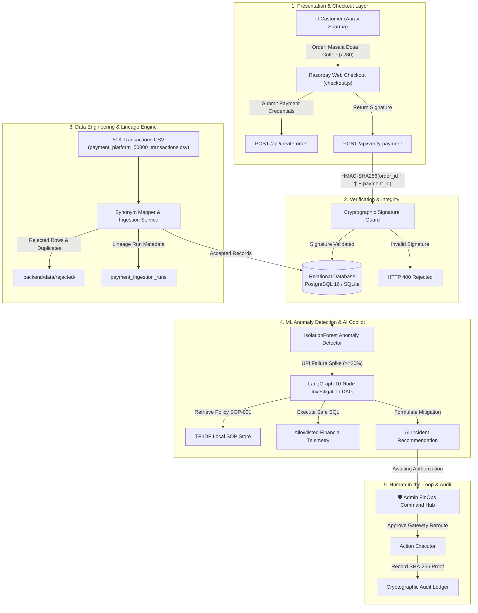

# PayBridge Payments
### AI-Powered FinOps & Payment Operations Platform

[](https://python.org)
[](https://fastapi.tiangolo.com)
[](https://streamlit.io)
[](https://www.postgresql.org)
[](https://langchain-ai.github.io/langgraph/)
[](https://ollama.ai)
[-brightgreen?style=flat-square)](tests/)
[](https://astral.sh/ruff)
[](LICENSE)

---

## 📌 Executive Overview

In digital payment systems processing high transaction volumes across UPI, NetBanking, and Cards, core banking switches (e.g., SBI, HDFC, ICICI, Axis) occasionally suffer transient latency spikes and switch degradation. When failure rates spike, naive payment systems silently drop transactions, miscalculate settlement schedules, or cause double-debits that trigger chargebacks.

**PayBridge Payments** is a production-grade FinOps and Payment Operations platform engineered to provide end-to-end platform observability:
- **Razorpay Standard Web Checkout**: Real-world checkout flow (`checkout.js`) with strict server-side HMAC-SHA256 signature verification.
- **Data Engineering Ingestion Pipeline**: Ingestion and validation engine pre-loaded with **50,000 synthetic transactions** across 10 Indian enterprise merchants.
- **Hybrid ML Anomaly Detection**: Unsupervised `IsolationForest` scoring combined with deterministic financial governance rules.
- **Agentic AI Copilot**: A 10-node Directed Acyclic Graph (**LangGraph**) that performs RAG retrieval over Standard Operating Procedures (SOPs), executes allowlisted SQL telemetry, and halts at a **Human-in-the-Loop (HITL)** approval gate before executing incident mitigations.
- **Cryptographic Audit Ledger**: Immutable SHA-256 chained logs recording all human actions, switch reroutes, and pipeline events.

---

## 🏗️ End-to-End System Architecture



---

## 👥 Three Unified Platform Roles

The frontend is organized around three distinct actors:

```
┌────────────────────────────────────────────────────────────────────────┐
│                        PAYBRIDGE PLATFORM ROLES                        │
├─────────────────────────┬───────────────────────┬──────────────────────┤
│       🛡️ ADMIN          │      🏪 MERCHANT      │     👤 CUSTOMER      │
├─────────────────────────┼───────────────────────┼──────────────────────┤
│ • FinOps Command Hub    │ • Rameshwaram Cafe    │ • Aarav Sharma       │
│ • Bank Switch Health    │ • Today's Orders      │ • Cart: ₹280         │
│ • 50K Data Lineage      │ • Store GMV & Volume  │ • Razorpay Checkout  │
│ • ML Anomaly Triage     │ • Cooking Tracker     │ • Live Order Status  │
│ • AI Investigation      │ • Payment Health      │ • Double-Debit Guard │
│ • Human Approval Gate   │ • Hold Advisories     │ • Instant Receipts   │
│ • Cryptographic Audit   │ • Business Metrics    │ • Transparent Ledger │
└─────────────────────────┴───────────────────────┴──────────────────────┘
```

1. **🛡️ Platform Administrator (Command Hub)**
   - Executive FinOps metrics: Total Transactions, GMV, Success Rates, Active Anomalies.
   - Real-time bank switch health (SBI, HDFC, ICICI, Axis).
   - Ingestion lineage monitoring for the 50,000 transaction dataset.
   - Anomaly triage table with one-click AI investigation.
   - Human-in-the-loop approval interface and tamper-evident audit history.

2. **🏪 Merchant Portal (RAMESHSWARAM CAFE)**
   - Real-world storefront perspective scoped to **RAMESHSWARAM CAFE** (`mid_rameshwaram_01`).
   - Live order stream with kitchen fulfillment states (`Order #RC10291`: Masala Dosa × 2, Filter Coffee × 1 = ₹280).
   - Practical business insights: today's successful vs. failed orders and customer fulfillment hold advisories.

3. **👤 Customer Portal (Aarav Sharma)**
   - Verified buyer profile (`cust_aarav_01`).
   - Seamless checkout button triggering official **Razorpay Standard Web Checkout**.
   - Verified payment status, double-debit protection guarantee, and order tracking.

---

## ⚡ Core Technical Modules

### 1. Payment Integration & Cryptographic Verification
- **Standard Web Checkout**: Native Razorpay integration (`checkout.js`) using public `RAZORPAY_KEY_ID`.
- **Order Creation API (`POST /api/create-order`)**: Generates official Razorpay orders with server-controlled pricing.
- **Server-Side HMAC-SHA256 Verification (`POST /api/verify-payment`)**:
  $$\text{Expected Signature} = \text{HMAC-SHA256}(\text{order\_id} + "|" + \text{payment\_id}, \text{RAZORPAY\_KEY\_SECRET})$$
  Evaluated using constant-time `hmac.compare_digest`. No mock fallbacks permitted in production mode.

### 2. Data Engineering & Canonical Ingestion (50K Records)
- **Heterogeneous Header Normalization**: Automatically detects column synonyms across bank exports (e.g., `txn_id`, `payment_ref` $\rightarrow$ `transaction_id`).
- **High-Speed Deduplication**: Employs in-memory pre-caching sets for $O(1)$ duplicate lookups, ingesting 50,000 records in under 15 seconds.
- **Lineage & Audit Trail**: Every ingestion batch writes a lineage record with accepted, rejected, and duplicate counts.
- **Row-Level Rejection Quarantine**: Corrupted records are partitioned to `backend/data/rejected/` with explicit failure reasons.

### 3. ML Anomaly Detection & Financial Rules Engine
- **Hybrid Scoring**: Unsupervised `IsolationForest` identifies multi-dimensional outliers in latency, volume, and failure rates.
- **Deterministic Severity Guardrails**: While ML proposes anomalies, hard business logic dictates severity (`CRITICAL`, `HIGH`, `MEDIUM`, `LOW`):
  - UPI Rail Failure Rate $\ge 20\%$ $\rightarrow$ `HIGH` / `CRITICAL`
  - Bank Switch Failure Rate $\ge 25\%$ $\rightarrow$ `HIGH`
  - Gateway Timeout Errors $\ge 15\%$ $\rightarrow$ `CRITICAL`

### 4. Sandboxed LangGraph Agent with HITL Approval
- **10-Node Directed Acyclic Graph**: Coordinates contextual investigation: Intake $\rightarrow$ Planning $\rightarrow$ Allowlisted SQL $\rightarrow$ SOP RAG $\rightarrow$ Synthesis $\rightarrow$ Evidence Validation $\rightarrow$ Recommendation $\rightarrow$ Human Gate $\rightarrow$ Action $\rightarrow$ Audit.
- **Zero Hallucination Guarantee**: All financial aggregations are computed via SQL `Decimal` arithmetic. The LLM is restricted to explanatory synthesis grounded in cited SOPs.
- **Human-in-the-Loop Gate**: High-impact operational mitigations (such as bank routing switch failovers) halt in state `AWAITING_APPROVAL` until an authorized administrator acts.

### 5. Standard Operating Procedures (SOP) Knowledge Base
- **SOP-001**: *UPI Bank Switch Degradation and Auto-Reroute Policy* (Latency thresholds >3,000 ms, failover conditions).
- **SOP-002**: *Fulfillment Hold Policy for Pending Bank Debits* (Preventing merchant inventory loss on pending debits).
- **SOP-003**: *Payment Reconciliation & Settlement Discrepancy SOP* (MDR fee validation, GST math, UTR tracking).
- **SOP-004**: *Dispute & Chargeback SLA Management Protocol* (Mandatory 7-day evidence submission windows).

---

## 📊 Enterprise Synthetic Dataset (50,000 Transactions)

Pre-loaded with 50,000 realistic transactions across 10 top Indian merchants:

| Merchant Name | Merchant ID | Category | Sample Reference | Txn Count |
| :--- | :--- | :--- | :--- | :--- |
| **RAMESHSWARAM CAFE** | `mid_rameshwaram_01` | Food & Dining | `RC-ORD-10291` | 5,000 |
| **URBAN EATS** | `mid_urbaneats_02` | Cloud Kitchen | `UE-ORD-20101` | 5,000 |
| **FRESH BASKET** | `mid_freshbasket_03` | Produce & Groceries | `FB-ORD-30101` | 5,000 |
| **TECHMART** | `mid_techmart_04` | Consumer Tech | `TM-ORD-40101` | 5,000 |
| **CITY PHARMACY** | `mid_citypharmacy_05`| Health & Pharma | `CP-ORD-50101` | 5,000 |
| **QUICK BITES** | `mid_quickbites_06` | Quick Service | `QB-ORD-60101` | 5,000 |
| **STYLE HUB** | `mid_stylehub_07` | Fashion & Apparel | `SH-ORD-70101` | 5,000 |
| **DAILY MART** | `mid_dailymart_08` | Supermarket | `DM-ORD-80101` | 5,000 |
| **TRAVEL POINT** | `mid_travelpoint_09` | Travel & Transit | `TP-ORD-90101` | 5,000 |
| **HOME NEEDS** | `mid_homeneeds_10` | Home Essentials | `HN-ORD-10010` | 5,000 |
| **TOTAL ECOSYSTEM** | — | — | — | **50,000 txns** |

---

## 🛠️ Technology Stack

| Component | Technology | Rationale |
| :--- | :--- | :--- |
| **Backend REST API** | FastAPI + Pydantic v2 | High-concurrency async ASGI framework with auto-generated OpenAPI documentation. |
| **Payment Gateway** | Razorpay Python SDK | Official SDK for order creation and server-side HMAC-SHA256 signature verification. |
| **Database Engine** | PostgreSQL 16 / SQLite | Dual-mode support: zero-configuration local SQLite and production PostgreSQL. |
| **ORM & Migrations** | SQLAlchemy 2.0 + Alembic | Declarative schema across 15 relational tables with `extend_existing=True` safety. |
| **AI State Machine** | LangGraph (LangChain) | Deterministic 10-node DAG state machine with native pause/resume human approval gates. |
| **Local LLM Inference**| Ollama (`qwen2.5:3b-instruct`) | Lightweight 3.1B parameter model running locally; zero egress costs; deterministic rule fallback. |
| **Knowledge Retrieval**| In-Process TF-IDF Vectorizer | Fast lexical search across banking SOPs with zero vector DB infrastructure overhead. |
| **Frontend UI** | Streamlit | Clean, modern FinTech operations dashboard organized into 3 clear role workspaces. |
| **Code Quality** | Ruff & Pytest | 100% automated test pass rate and zero linting violations. |

---

## 🚀 Quickstart & Local Setup

### Prerequisites
- Python 3.11, 3.12, or 3.13
- Git

### 1. Clone the Repository
```bash
git clone https://github.com/naveenkotnana/PayBridge-Payments-AI-Powered-FinOps-Payment-Operations-Platform.git
cd PayBridge-Payments-AI-Powered-FinOps-Payment-Operations-Platform
```

### 2. Set Up Virtual Environment & Dependencies
```powershell
# Create virtual environment
python -m venv .venv

# Activate virtual environment (Windows PowerShell)
.venv\Scripts\Activate.ps1

# (Linux / macOS: source .venv/bin/activate)

# Install production dependencies
pip install -r requirements.txt
```

### 3. Configure Environment Variables
```powershell
cp .env.example .env
```
*(Optional: Add your Razorpay Test API keys into `.env` to test live checkout popups. Default mode runs immediately).*
```env
RAZORPAY_KEY_ID=rzp_test_YourKeyId
RAZORPAY_KEY_SECRET=YourKeySecret
```

### 4. Bootstrap Database & Ingest 50,000 Transactions
```powershell
python backend/scripts/setup_all.py
```
*This initializes database tables, seeds demo users, generates the 50,000 synthetic transaction dataset, and ingests all records.*

### 5. Run Platform Services

**Terminal 1 — FastAPI Backend Engine:**
```powershell
python -m uvicorn backend:app --host 127.0.0.1 --port 8000
```
- API Health: [http://127.0.0.1:8000/health](http://127.0.0.1:8000/health)
- Swagger API Docs: [http://127.0.0.1:8000/docs](http://127.0.0.1:8000/docs)
- Platform Landing Page: [http://127.0.0.1:8000](http://127.0.0.1:8000)

**Terminal 2 — Streamlit FinOps Operations Hub:**
```powershell
python -m streamlit run frontend/dashboard.py --server.port 8501
```
- Web Application: [http://localhost:8501](http://localhost:8501)

---

## 🧪 Verification & Automated Testing

The repository maintains strict verification benchmarks:

```powershell
# 1. Run all unit and integration tests (117 tests)
python -m pytest tests/unit/ tests/integration/ -v

# 2. Run Ruff static code analysis
python -m ruff check backend frontend ml tests
```

### Benchmark Results
- **Automated Test Suite**: **117 / 117 PASSED (100%)**
- **Ruff Code Quality**: **0 ERRORS (All checks passed)**
- **50K Record Ingestion Benchmark**: **50,000 rows accepted, 0 dropped, 12.6s execution**
- **Security Check**: Secret keys strictly validated server-side; zero frontend leakage.

---

## 📁 Repository Structure

```text
PayBridge-Payments-AI-Powered-FinOps-Payment-Operations-Platform/
│
├── backend/
│   ├── app/
│   │   ├── agent/            # LangGraph 10-node DAG, state models, investigation tools
│   │   ├── analytics/        # Deterministic SQL FinOps queries & MDR calculation
│   │   ├── api/              # FastAPI endpoints (checkout, events, health, audit)
│   │   ├── core/             # RBAC configuration, security, JWT authentication
│   │   ├── db/               # SQLAlchemy engine, session maker & DeclarativeBase
│   │   ├── models/           # Relational schema (payments, merchants, orders, audit)
│   │   ├── rag/              # TF-IDF vector index & Payment SOP retriever
│   │   ├── services/         # Canonical CSV mapper, SSRF URL fetcher, reconciliation
│   │   └── static/           # Static landing page (3 core role portals)
│   ├── data/                 # Datasets, banking SOPs, rejected row archives
│   ├── scripts/              # Bootstrap scripts & 50K generation/ingestion pipeline
│   └── main.py               # Backend ASGI entrypoint
├── frontend/
│   ├── views/                # Role views (admin_dashboard, merchant_portal, customer_portal)
│   ├── dashboard.py          # Unified Streamlit operations dashboard
│   ├── components.py         # Reusable UI widgets & API client
│   └── styles.py             # Custom FinTech design tokens & HTML renderers
├── ml/                       # Machine Learning anomaly detection (IsolationForest)
├── tests/
│   ├── unit/                 # Unit tests (checkout, ingestion, analytics, security)
│   └── integration/          # End-to-end REST API & pipeline tests
├── .env.example              # Environment variables template
├── .gitignore                # Comprehensive Git ignore rules
├── README.md                 # Project architectural documentation
└── requirements.txt          # Production dependencies
```

---

## 📄 License & Attribution

Architected and developed by **Naveen Kotnana** as an enterprise-grade FinOps & Payment Operations Portfolio Platform.  
*Inspired by the resilient design principles of modern Indian digital payments infrastructure.*  
Distributed under the **[MIT License](LICENSE)**.
